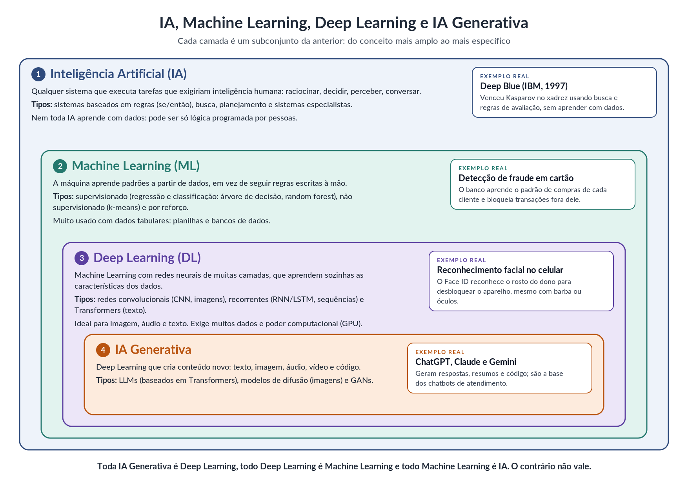

# 03 · IA, Machine Learning, Deep Learning e IA Generativa

Mapa mental de uma página relacionando os quatro conceitos, com um exemplo real de cada.

Versão em PDF: [mapa-mental.pdf](mapa-mental.pdf)

## Resumo

Os conceitos formam camadas, uma dentro da outra: toda IA Generativa é Deep Learning, todo Deep Learning é Machine Learning e todo Machine Learning é IA, mas o contrário não vale.

| Camada | Ideia central | Exemplo real |
|--------|---------------|--------------|
| Inteligência Artificial | Sistemas que executam tarefas que exigiriam inteligência humana, com ou sem aprendizado | Deep Blue (IBM, 1997), que venceu Kasparov no xadrez usando busca e regras |
| Machine Learning | Aprende padrões a partir de dados | Detecção de fraude em cartão de crédito |
| Deep Learning | Redes neurais de muitas camadas, para imagem, áudio e texto | Reconhecimento facial para desbloquear o celular |
| IA Generativa | Cria conteúdo novo: texto, imagem, áudio e código | ChatGPT, Claude e Gemini |
