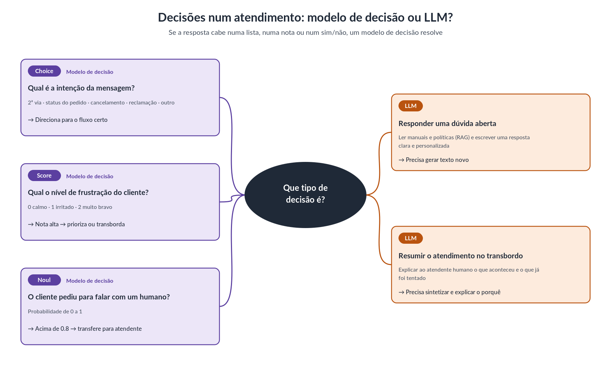
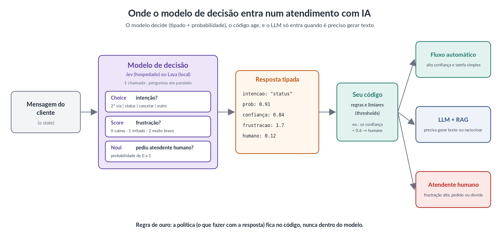

# 07 · Modelos de decisão: Jev e Laya

Quadro comparando LLM, SLM e modelo de decisão, mais um mapa mental com três decisões que cabem em um modelo de decisão e duas que exigem um LLM. Abaixo da entrega, um material de estudo mais aprofundado sobre o tema.

---

## Entrega

### LLM x SLM x Modelo de decisão

| Critério | LLM | SLM | Modelo de decisão (Jev / Laya) |
|----------|-----|-----|-------------------------------|
| **O que devolve** | Texto livre, gerado token a token | Texto livre, gerado token a token (em domínio mais restrito) | Valor tipado: uma opção de uma lista (Choice), uma nota numa escala (Score) ou uma probabilidade de sim/não (Noul), sempre com probabilidade e confiança |
| **Custo** | O mais alto: paga entrada e saída, e a saída custa caro | Bem menor; rodando localmente, o custo vira infraestrutura | O mais baixo: o Jev cobra só a entrada (saída grátis); o Laya é open source e roda na sua máquina |
| **Velocidade** | Segundos | Rápido, principalmente local | Milissegundos (todas as perguntas respondidas em paralelo, numa única chamada) |
| **Quando usar** | Precisa gerar texto, explicar, raciocinar em várias etapas ou lidar com o imprevisto | Tarefas de texto delimitadas, alto volume e dados que não podem sair da empresa | A resposta cabe numa lista, numa nota ou num sim/não, e a decisão se repete milhares de vezes |

### Mapa mental



Versão em PDF: [mapa-mental.pdf](mapa-mental.pdf)

**Cabem em um modelo de decisão**
1. **Qual é a intenção da mensagem?** (Choice: 2ª via, status do pedido, cancelamento, reclamação, outro) → direciona para o fluxo certo.
2. **Qual o nível de frustração do cliente?** (Score: calmo, irritado, muito bravo) → nota alta prioriza ou transborda.
3. **O cliente pediu para falar com um humano?** (Noul: probabilidade de 0 a 1) → acima de 0,8, transfere para um atendente.

**Exigem um LLM**
1. **Responder uma dúvida aberta**, consultando manuais e políticas (RAG) e escrevendo uma resposta clara e personalizada.
2. **Resumir o atendimento no transbordo**, explicando ao atendente humano o que aconteceu e o que já foi tentado.

---

## Material de estudo

### 1. O problema que o modelo de decisão resolve

Boa parte das chamadas de LLM em produção não precisa de um parágrafo, precisa de **uma decisão**: "isso é urgente?", "qual equipe atende?", "essa resposta está correta?". Usar um LLM para isso tem três custos:

- **Lento:** o LLM gera token por token, então até um simples JSON leva tempo.
- **Caro:** paga-se entrada e saída, e em alto volume a conta cresce rápido.
- **Frágil:** a saída é texto, que precisa ser interpretado (parsing), pode quebrar o formato e não traz uma probabilidade confiável.

O modelo de decisão nasce para esse formato de problema: **um julgamento rápido, repetido milhares de vezes, cuja resposta é um único valor.**

### 2. System 1 x System 2

A TypeSafe chama o Jev de **System One Model**, em referência ao livro *Rápido e Devagar* (Daniel Kahneman):

| | System 1 | System 2 |
|---|----------|----------|
| No humano | Julgamento rápido e automático (ler o humor de alguém pelo rosto) | Raciocínio lento e trabalhoso (resolver uma conta difícil) |
| Na IA | **Modelo de decisão**: resposta imediata, tipada | **LLM**: pensa token a token, gera texto, raciocina em etapas |

Os dois se complementam. O sistema bem desenhado usa o System 1 para triar e o System 2 só quando precisa.

### 3. Como funciona: state + perguntas tipadas

Toda chamada tem o mesmo formato: um **state** (o contexto, em texto ou JSON) e um conjunto de **perguntas tipadas**.

| Primitiva | Pergunta | Devolve |
|-----------|----------|---------|
| **Choice** | Qual destas opções? | A opção escolhida, a probabilidade de cada opção e uma confiança |
| **Score** | Em que nível desta escala? | Uma nota, a probabilidade de cada nível e uma confiança |
| **Noul** | Isto é verdade? | Uma probabilidade de 0 a 1 (o nome vem de *Bernoulli*) |

Exemplo (adaptado da documentação da TypeSafe):

```json
{
  "state": "Estou tentando pagar a fatura há 3 dias e dá erro. Preciso resolver HOJE.",
  "model": "jev-1.13.0",
  "questions": {
    "intencao": {
      "type": "choice",
      "instructions": "Qual é o assunto principal da mensagem",
      "criteria": {
        "segunda_via": "Pedido de boleto ou fatura",
        "pagamento": "Problema ao pagar",
        "cancelamento": "Quer cancelar o serviço"
      }
    },
    "frustracao": {
      "type": "score",
      "instructions": "Quão frustrado o cliente parece",
      "criteria": ["Calmo", "Irritado, mas educado", "Muito bravo"]
    },
    "urgente": {
      "type": "noul",
      "instructions": "A mensagem transmite urgência"
    }
  }
}
```

Resposta (ilustrativa):

```json
{
  "answers": {
    "intencao":   { "choice": "pagamento", "probabilities": { "segunda_via": 0.08, "pagamento": 0.90, "cancelamento": 0.02 }, "confidence": 0.81 },
    "frustracao": { "score": 1.4, "confidence": 0.77 },
    "urgente":    { "noul": 0.97 }
  }
}
```

Não há texto para interpretar: `intencao.choice` é sempre uma das chaves que você definiu, e `urgente.noul` é um número que você compara com um limite (threshold).

**Por que é tão rápido:** o modelo lê o state uma vez e responde todas as perguntas na mesma passada, em paralelo, sem gerar texto. Por isso, no Jev, a saída é gratuita.

**Probabilidade x confiança:** a probabilidade diz *qual* é a resposta; a confiança diz *se vale agir* sobre ela. Boa prática: agir acima de um limite e escalar (para um LLM ou um humano) abaixo dele.

**Calibração:** um modelo bem calibrado que diz "0,9" em 100 casos deve acertar cerca de 90. O Jev é treinado com um método chamado RLCD (*Reinforcement Learning for Calibrated Decisions*) justamente para isso. Mesmo assim, calibração deve ser **testada no seu caso de uso**, não assumida.

### 4. Onde ele entra na arquitetura



O padrão é sempre o mesmo: **uma etapa gera o state, o modelo de decisão julga, e o seu código age.** A regra de negócio (o que fazer com a resposta) fica no código, nunca dentro do modelo.

Usos comuns: classificar e rotear mensagens, roteamento de modelos (mandar para um modelo barato ou caro conforme a dificuldade), reranking de resultados de busca, checar se uma citação realmente apoia a afirmação, filtrar tentativas de prompt injection e avaliar se uma ação de um agente é perigosa antes de executá-la.

### 5. Jev x Laya

| | Jev (TypeSafe) | Laya |
|---|----------------|------|
| Tipo | Serviço hospedado, pesos fechados, acesso por API | Open source (Apache 2.0), roda localmente |
| Modelo | Arquitetura própria da TypeSafe | Baseado em ModernBERT, cerca de 421 milhões de parâmetros |
| Custo | US$ 0,042 por milhão de tokens de entrada; saída grátis | Sem custo de licença; você paga a infraestrutura (GPU/CPU) |
| Latência | ~70 a 500 ms | ~33 ms por decisão em uma GPU (dado do próprio projeto) |
| Precisão | Em geral mais preciso "de fábrica" | Varia por tarefa; cai bastante em listas com muitas opções; melhora muito com fine-tuning |
| Privacidade | Dados vão para a API da TypeSafe | Dados ficam na sua infraestrutura |
| Compatibilidade | API `/v1/systemone` | Fala a mesma API: dá para trocar mudando a URL |

Resumo: **Jev** para começar rápido e com mais precisão; **Laya** quando os dados não podem sair da empresa, quando o volume torna a API cara, ou quando você quer ajustar o modelo para o seu domínio.

### 6. Armadilhas e limitações

- **"Não alucina" ≠ "não erra".** O modelo nunca devolve algo fora das opções que você definiu, mas pode escolher a opção errada.
- **Leitura literal:** responde exatamente o que você perguntou, não o que você quis dizer. Escreva critérios claros e inclua os casos de fronteira.
- **Contas, contagens e datas:** não é calculadora. Faça a matemática no código.
- **Perguntas indiretas (várias etapas):** perdem precisão. Quebre em perguntas menores.
- **State grande e com ruído:** informação irrelevante atrapalha. Mande só o necessário.
- **Conteúdo malicioso:** instruções escondidas no texto podem influenciar a resposta. Critérios específicos e testes ajudam.
- **Não gera texto:** para escrever, explicar ou criar, use um LLM.
- **A probabilidade pode estar mal calibrada:** avalie com dados reais antes de confiar nos limites.

### 7. Boas práticas para produção

1. Comece com **uma decisão só**, com critérios bem literais.
2. Compare com o que você usa hoje (LLM, regra ou humano) em **pelo menos 100 exemplos reais**.
3. Defina **limites (thresholds)** e um caminho de escalonamento para os casos de baixa confiança.
4. **Fixe a versão** do modelo (ex.: `jev-1.13.0`, não `jev-latest`) para o comportamento não mudar sem aviso.
5. Monitore a taxa de acerto e a distribuição das probabilidades ao longo do tempo.

### 8. Vocabulário para reunião

| Termo | Significado |
|-------|-------------|
| Typed output / saída tipada | Resposta com formato garantido (opção, número ou probabilidade) |
| Calibration / calibração | Quanto as probabilidades batem com a realidade |
| Threshold / limiar | Valor de corte a partir do qual o sistema age |
| Routing / roteamento | Decidir para onde vai a mensagem (fluxo, modelo ou humano) |
| Reranking | Reordenar resultados de busca por relevância |
| Human in the loop | Humano entra quando o modelo não tem confiança suficiente |
| Escalation / transbordo | Passar o caso para um nível acima (LLM mais forte ou atendente) |

### 9. Conexão com um projeto real: o score de prioridade do UrbanIQ

No [UrbanIQ](https://github.com/Ant4rez/UrbanIq), cada chamado urbano recebe um **score de prioridade de 0 a 100**, calculado por uma fórmula ponderada (risco, tempo em aberto, reiterações e um bônus de equidade para territórios que pedem pouco), e o sistema usa esse número para priorizar o atendimento.

| | Score do UrbanIQ | Modelo de decisão (Jev / Laya) |
|---|---|---|
| Natureza | **Regra determinística**: fórmula com pesos definidos por pessoas | **Modelo aprendido**: julgamento treinado com dados |
| Entrada | Campos estruturados (categoria, datas, contagem de reiterações) | Texto livre ou JSON (o state) |
| Saída | Um número de 0 a 100 | Opção, nota ou probabilidade, com confiança |
| Explicabilidade | Total: dá para mostrar a conta | Parcial: mostra probabilidades, não o "porquê" |
| O que faz bem | Combinar números de forma transparente e auditável | Entender a linguagem do cidadão |

**A parte interessante é que eles se completam.** Um modelo de decisão poderia ler a descrição livre do chamado ("tem um fio caído na frente da escola") e extrair o que a fórmula precisa: o nível de risco (Score), se é reiteração de outro chamado (Noul) e a subcategoria certa (Choice). A fórmula do UrbanIQ continuaria fazendo a conta no código. É exatamente a boa prática do Jev: **o modelo julga, a matemática fica no código.**

### Fontes

- [InfoQ: TypeSafe AI Releases Jev](https://www.infoq.com/news/2026/10/typesafe-ai-jev-released/)
- [Firecrawl: What Is Jev? Inside TypeSafe's Decision-Only AI Model](https://www.firecrawl.dev/blog/what-is-jev)
- [Laya vs. TypeSafe Jev (Laya Studio)](https://laya.studio/blog/laya-vs-typesafe-jev-choosing-your-system-1-decision-model)
- [Laya: The Open-Source Jev Alternative, Benchmarked Honestly (Flowtivity)](https://flowtivity.ai/blog/laya-open-source-jev-alternative/)
- [Type-Safe Is Not Error-Free (arXiv)](https://arxiv.org/pdf/2609.26758)
