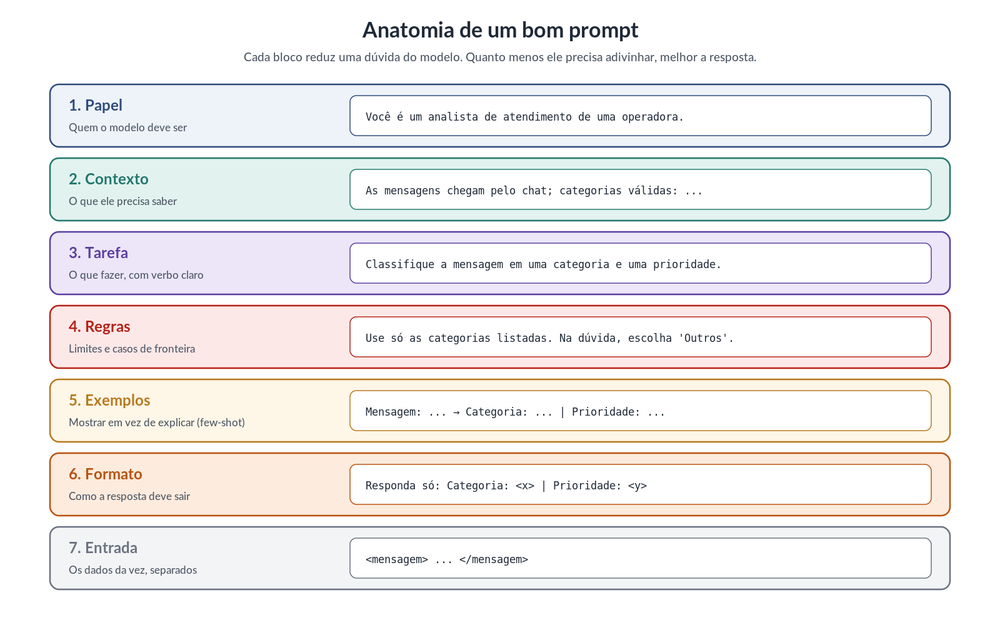
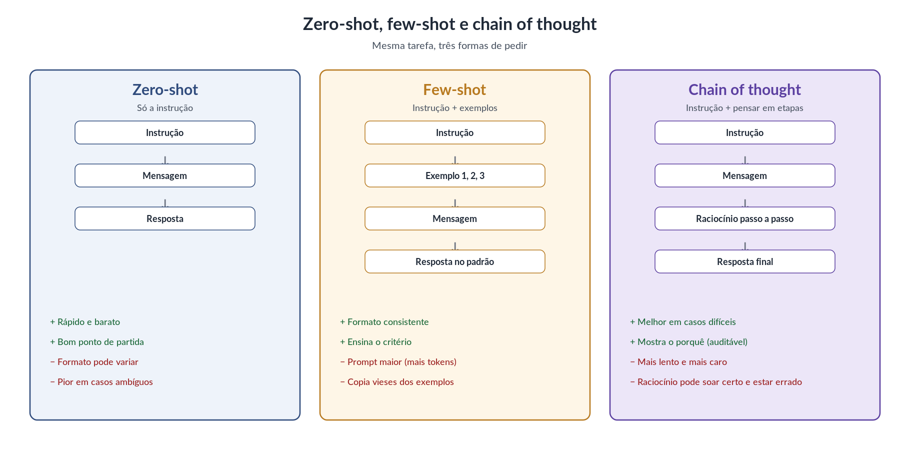

# 08 · Engenharia de prompt

Três prompts para a mesma tarefa (zero-shot, few-shot e chain of thought), com as respostas obtidas e um comparativo. Abaixo da entrega, um material de estudo mais aprofundado sobre o tema.

---

## Entrega

### A tarefa

Classificar a mensagem de um cliente de atendimento em **uma categoria** e **uma prioridade**. Escolhi de propósito uma mensagem ambígua, que mistura problema de pagamento com ameaça de cancelamento:

> "Paguei a fatura ontem pelo Pix, mas no app ainda aparece em aberto e hoje chegou cobrança com juros. Se não resolverem até amanhã vou cancelar tudo."

Categorias válidas: Segunda via · Pagamento não identificado · Cancelamento · Reclamação · Outros
Prioridades: Baixa · Média · Alta

### 1. Zero-shot (só a instrução)

**Prompt**

```text
Classifique a mensagem do cliente abaixo em uma categoria e uma prioridade.
Categorias: Segunda via, Pagamento não identificado, Cancelamento, Reclamação, Outros.
Prioridades: Baixa, Média, Alta.

Mensagem: "Paguei a fatura ontem pelo Pix, mas no app ainda aparece em aberto e hoje chegou cobrança com juros. Se não resolverem até amanhã vou cancelar tudo."
```

**Resposta obtida**

```text
A mensagem se encaixa melhor na categoria "Pagamento não identificado", já que o cliente
afirma ter pago a fatura, mas o sistema não reconheceu o pagamento. A prioridade é Alta,
porque há cobrança de juros e o cliente ameaça cancelar o serviço.
```

### 2. Few-shot (instrução + exemplos)

**Prompt**

```text
Classifique a mensagem do cliente em uma categoria e uma prioridade, seguindo o padrão dos exemplos.
Categorias: Segunda via, Pagamento não identificado, Cancelamento, Reclamação, Outros.
Prioridades: Baixa, Média, Alta.

Mensagem: "Preciso do boleto desse mês, perdi o e-mail."
Categoria: Segunda via | Prioridade: Baixa

Mensagem: "Quero cancelar meu plano, vou mudar de cidade."
Categoria: Cancelamento | Prioridade: Média

Mensagem: "Já é a terceira vez que ligo e ninguém resolve minha internet. Péssimo atendimento!"
Categoria: Reclamação | Prioridade: Alta

Mensagem: "Paguei a fatura ontem pelo Pix, mas no app ainda aparece em aberto e hoje chegou cobrança com juros. Se não resolverem até amanhã vou cancelar tudo."
Categoria:
```

**Resposta obtida**

```text
Pagamento não identificado | Prioridade: Alta
```

### 3. Chain of thought (pensar em etapas antes de responder)

**Prompt**

```text
Classifique a mensagem do cliente em uma categoria e uma prioridade.
Categorias: Segunda via, Pagamento não identificado, Cancelamento, Reclamação, Outros.
Prioridades: Baixa, Média, Alta.

Antes de responder, pense passo a passo:
1. Qual é o problema principal que o cliente relata?
2. Há algum assunto secundário ou ameaça?
3. Qual categoria resolve a causa do problema, e não só o sintoma?
4. Qual prioridade, considerando impacto e prazo?

Escreva o raciocínio entre <raciocinio></raciocinio> e a resposta final no formato:
Categoria: <categoria> | Prioridade: <prioridade>

Mensagem: "Paguei a fatura ontem pelo Pix, mas no app ainda aparece em aberto e hoje chegou cobrança com juros. Se não resolverem até amanhã vou cancelar tudo."
```

**Resposta obtida**

```text
<raciocinio>
1. O problema principal é um pagamento feito por Pix que não foi reconhecido: a fatura segue em aberto e gerou juros.
2. Há uma ameaça de cancelamento, mas ela é consequência do problema, não o pedido principal.
3. Se o pagamento for identificado, a cobrança de juros e a ameaça de cancelamento deixam de existir.
   Por isso a categoria certa é "Pagamento não identificado", e não "Cancelamento" nem "Reclamação".
4. Há prejuízo financeiro (juros), prazo curto (até amanhã) e risco de perder o cliente: prioridade Alta.
</raciocinio>
Categoria: Pagamento não identificado | Prioridade: Alta
```

### Comparativo

| | Zero-shot | Few-shot | Chain of thought |
|---|---|---|---|
| Acertou a categoria? | Sim | Sim | Sim |
| Formato da resposta | Livre, em texto corrido: difícil de ler por código | Exatamente o padrão dos exemplos | Padrão definido, com o raciocínio separado em tags |
| Explica o porquê? | Um pouco | Não | Sim, e trata a ambiguidade (pagamento x cancelamento) |
| Tamanho do prompt e da resposta | Menor | Prompt maior (exemplos) e resposta curta | Resposta maior (mais tokens, mais custo e latência) |
| Melhor para | Testes rápidos e tarefas simples | Produção em alto volume, quando o formato importa | Casos ambíguos, auditoria e avaliação de qualidade |

**Conclusão:** com um modelo grande, as três técnicas acertaram a categoria. A diferença apareceu na **forma**: o zero-shot respondeu em texto livre, o few-shot entregou exatamente o padrão que um sistema consegue ler, e o chain of thought mostrou o raciocínio, separando a causa (pagamento) da consequência (ameaça de cancelamento). Em modelos menores, ou com mensagens ainda mais ambíguas, a diferença de acerto tende a aumentar. Num chatbot real, eu usaria **few-shot** no fluxo do dia a dia e **chain of thought** para revisar os casos de baixa confiança.

> As respostas foram geradas com o Claude. Como os modelos variam de uma chamada para outra, rodar os mesmos prompts de novo pode trazer pequenas diferenças de texto.

---

## Material de estudo

### 1. O que é engenharia de prompt (e por que importa)

O prompt é a **especificação da tarefa** para o modelo. O mesmo modelo pode dar uma resposta ruim ou excelente dependendo de como a instrução é escrita, porque ele não "sabe" o que você quer: ele continua o texto da forma mais provável, a partir do que recebeu. Quanto menos ele precisa adivinhar, melhor.

Em produção, isso vira **engenharia de contexto**: decidir o que entra no prompt a cada chamada (instruções, exemplos, documentos do RAG, histórico), já que tudo ocupa a janela de contexto e influencia a resposta.

### 2. Anatomia de um bom prompt



Nem todo prompt precisa dos sete blocos, mas pensar em cada um evita os erros mais comuns: tarefa vaga, falta de regras para casos de fronteira e formato de saída indefinido.

### 3. As três técnicas



**Zero-shot:** só a instrução, sem exemplos. Funciona bem em modelos grandes para tarefas comuns. É o ponto de partida: comece por aqui e só complique se o resultado não for bom o bastante.

**Few-shot:** instrução + alguns exemplos de entrada e saída. O modelo aprende o critério e o formato "vendo", não só "lendo". Boas práticas:
- Use de **3 a 5 exemplos variados**, cobrindo as categorias e pelo menos um caso difícil.
- Mantenha os exemplos **balanceados**: se 4 de 5 forem "Alta", o modelo tende a responder "Alta".
- Use **exatamente o mesmo formato** em todos os exemplos.
- Cuidado: o modelo copia também os erros e vieses dos exemplos.

**Chain of thought (CoT):** pedir para o modelo raciocinar em etapas antes da resposta final. Ajuda em tarefas com várias etapas, ambiguidade ou cálculo. Boas práticas:
- Separe o **raciocínio** da **resposta** (tags como `<raciocinio>` e um formato fixo no final), para o código conseguir ler só a resposta.
- Não mostre o raciocínio ao cliente final; ele é para o sistema e para quem audita.
- Modelos de raciocínio (com *extended thinking*) já pensam antes de responder. Neles, pedir "pense passo a passo" costuma ser desnecessário: o ganho vem mais de dar contexto e critérios claros.
- Um raciocínio bem escrito pode estar errado. Ele aumenta a transparência, não garante a correção.

### 4. Dicas que fazem diferença

- **Seja específico e positivo:** "Responda em até 2 frases" funciona melhor do que "não seja prolixo".
- **Use delimitadores** para separar instruções de dados (`<mensagem>...</mensagem>`). Isso também ajuda contra prompt injection.
- **Defina o formato de saída**, de preferência com saída estruturada (JSON com schema) quando um sistema for ler a resposta.
- **Explique o porquê das regras:** "não use abreviações, porque o texto será lido em voz alta pela URA" dá ao modelo um critério para casos não previstos.
- **Dê uma saída para a dúvida:** "se não tiver certeza, responda 'Outros'" reduz respostas inventadas.

### 5. Outras técnicas que aparecem no dia a dia

| Técnica | Ideia |
|---|---|
| **Role prompting** | Definir um papel ("você é um analista de atendimento") para ajustar tom e critério |
| **Prompt chaining** | Quebrar uma tarefa grande em várias chamadas menores, uma alimentando a outra |
| **Self-consistency** | Rodar o mesmo prompt várias vezes e ficar com a resposta mais frequente |
| **ReAct** | O modelo alterna raciocínio e ação (chamar ferramentas, buscar dados): base dos agentes |
| **Templates com variáveis** | Prompt fixo com campos que mudam a cada chamada (`{mensagem}`, `{historico}`) |

### 6. Como avaliar um prompt (evals)

Prompt não se avalia "no olho" com um exemplo só. O processo profissional:

1. Monte um **conjunto de teste** com casos reais e a resposta esperada de cada um (incluindo casos difíceis).
2. Rode cada versão do prompt sobre esse conjunto.
3. Meça **acerto**, **formato válido**, **custo (tokens)** e **latência**.
4. **Versione os prompts** (v1, v2, v3) e só troque em produção quando a nova versão for melhor nas métricas.

É exatamente o trabalho de avaliação de prompts e conversas de um time de IA aplicada.

### 7. Vocabulário

| Termo | Significado |
|---|---|
| Prompt / system prompt | A instrução enviada ao modelo; o system prompt define o comportamento fixo do assistente |
| Zero-shot / few-shot | Sem exemplos / com alguns exemplos no prompt |
| Chain of thought (CoT) | Raciocínio passo a passo antes da resposta |
| Delimitadores | Marcadores que separam instruções de dados (ex.: tags XML) |
| Structured output | Saída num formato garantido, como JSON com schema |
| Eval | Teste sistemático da qualidade das respostas |
| Prompt injection | Texto malicioso que tenta sobrescrever as instruções do sistema |

### Fontes

- [Anthropic: Prompt engineering overview](https://docs.claude.com/en/docs/build-with-claude/prompt-engineering/overview)
- [Brown et al. (2020): Language Models are Few-Shot Learners](https://arxiv.org/abs/2005.14165)
- [Wei et al. (2022): Chain-of-Thought Prompting Elicits Reasoning in Large Language Models](https://arxiv.org/abs/2201.11903)
- [Kojima et al. (2022): Large Language Models are Zero-Shot Reasoners](https://arxiv.org/abs/2205.11916)
- [Wang et al. (2022): Self-Consistency Improves Chain of Thought Reasoning](https://arxiv.org/abs/2203.11171)
- [Yao et al. (2022): ReAct: Synergizing Reasoning and Acting in Language Models](https://arxiv.org/abs/2210.03629)
