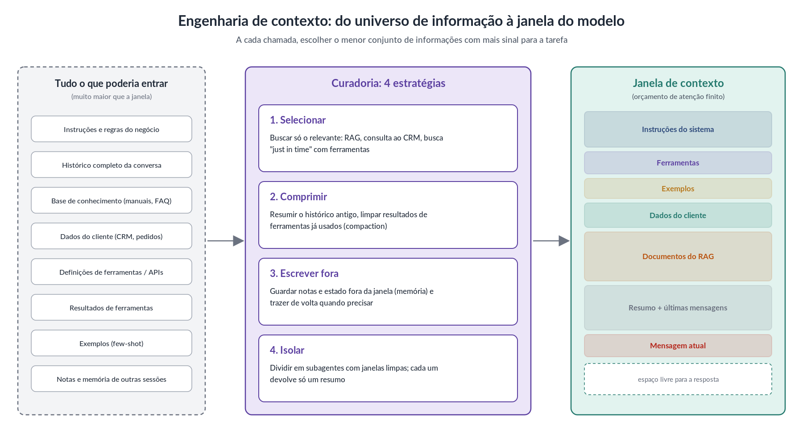
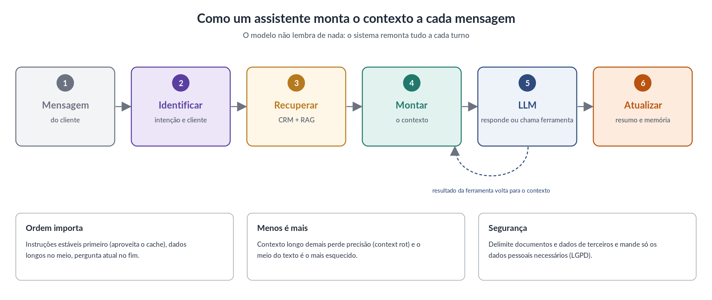

# 09 · Engenharia de contexto

Quadro comparando engenharia de prompt e engenharia de contexto, mais a lista do que deveria entrar no contexto de um assistente. Abaixo da entrega, um material de estudo mais aprofundado sobre o tema.

---

## Entrega

### Engenharia de prompt x engenharia de contexto

| Critério | Engenharia de prompt | Engenharia de contexto |
|---|---|---|
| **Foco** | Como escrever a instrução | O que entra na janela do modelo a cada chamada |
| **Pergunta central** | "Qual é a melhor forma de pedir?" | "Qual conjunto de informações tem mais chance de gerar a resposta certa?" |
| **Escopo** | O texto do prompt (principalmente o system prompt) | Tudo que o modelo recebe: instruções, histórico, documentos, dados do cliente, ferramentas, resultados de ferramentas e memória |
| **Quando acontece** | Uma vez, ao escrever o prompt (e em revisões) | A cada chamada: o contexto é remontado dinamicamente |
| **Natureza** | Estática: um texto bem escrito | Dinâmica: um sistema que seleciona, resume e organiza informação |
| **Técnicas típicas** | Papel, instruções claras, few-shot, chain of thought, formato de saída | RAG, resumo do histórico (compaction), memória fora da janela, seleção de ferramentas, subagentes, ordem dos blocos |
| **Problema que resolve** | Instrução vaga ou ambígua | Excesso de informação, informação faltando ou desatualizada, perda de foco em conversas longas |
| **Onde mais importa** | Tarefas de uma chamada só (classificar, resumir, extrair) | Assistentes e agentes com várias rodadas, ferramentas e fontes de dados |
| **Relação** | É uma parte da engenharia de contexto | É a evolução natural da engenharia de prompt |

**Em uma frase:** a engenharia de prompt cuida de *como pedir*; a engenharia de contexto cuida de *tudo o que o modelo enxerga quando você pede*.

### O que deveria entrar no contexto de um assistente de atendimento

1. **Instruções do sistema:** papel do assistente, objetivo, tom de voz, regras do negócio e o que ele não pode fazer (ex.: não prometer prazos que não estão no sistema).
2. **Regras de segurança e escalonamento:** quando transferir para um humano, como lidar com dados sensíveis e o que fazer em caso de dúvida.
3. **Dados do cliente relevantes para a conversa:** nome, plano, status do pedido ou da fatura, vindos do CRM. Só o necessário (minimização da LGPD).
4. **Documentos recuperados (RAG):** apenas os trechos da base de conhecimento que respondem à pergunta da vez, com a fonte, e não a base inteira.
5. **Histórico da conversa:** as últimas mensagens completas e um resumo das anteriores, preservando o que importa (número do pedido, o que já foi tentado, o que o cliente pediu).
6. **Ferramentas disponíveis:** só as necessárias para a tarefa (ex.: consultar pedido, gerar segunda via, abrir chamado), com descrição clara de quando usar cada uma.
7. **Resultados de ferramentas:** o retorno da última consulta (ex.: "pagamento identificado em 22/11"), resumido quando for longo.
8. **Exemplos (few-shot):** poucos exemplos canônicos do comportamento esperado, principalmente para formato e tom.
9. **Memória de longo prazo, quando houver:** fatos já confirmados em atendimentos anteriores (ex.: "cliente prefere contato por WhatsApp").
10. **A mensagem atual do cliente**, no final, delimitada.

**O que deve ficar de fora:** documentos inteiros quando um trecho resolve, histórico antigo sem resumo, resultados brutos de ferramentas já usados, ferramentas que não servem para a tarefa, dados pessoais desnecessários e informações duplicadas ou desatualizadas.

---

## Material de estudo

### 1. Por que a engenharia de prompt "evoluiu"

Enquanto o uso de LLMs era uma chamada só (classificar, resumir, traduzir), escrever um bom prompt resolvia quase tudo. Com assistentes e agentes que conversam por muitas rodadas, consultam sistemas e usam ferramentas, o problema mudou: a cada rodada aparece mais informação que *poderia* ser útil, e ela precisa caber numa janela limitada. A Anthropic define o objetivo assim: encontrar **o menor conjunto possível de tokens com alto sinal** que maximize a chance do resultado desejado.

### 2. Por que "mais contexto" não é "melhor contexto"

- **Context rot:** conforme o contexto cresce, o modelo perde precisão para recuperar informações dele. Isso acontece em todos os modelos, muito antes do limite da janela.
- **Lost in the middle:** o modelo usa melhor o começo e o fim do contexto; o que fica no meio é mais "esquecido".
- **Orçamento de atenção:** no transformer, cada token se relaciona com todos os outros. Quanto mais tokens, mais diluída fica a atenção.
- **Custo e latência:** como o modelo não tem memória, tudo é reenviado a cada chamada. Contexto inchado é pago (e esperado) em todas as rodadas.

### 3. Como o contexto é curado

As quatro estratégias mais usadas:

| Estratégia | O que faz | Exemplo no atendimento |
|---|---|---|
| **Selecionar** | Traz só o que é relevante para a pergunta da vez | RAG com os 3 trechos mais relevantes; consulta ao CRM só do pedido citado |
| **Comprimir** | Reduz o que já está na janela | Resumir mensagens antigas; apagar resultados de ferramentas já usados |
| **Escrever fora** | Guarda informação fora da janela e traz quando precisar | Notas da conversa, preferências do cliente, estado do atendimento |
| **Isolar** | Divide o trabalho em contextos separados | Um subagente pesquisa a política de reembolso e devolve só um resumo |

### 4. Como um assistente monta o contexto a cada mensagem

Pontos de atenção na montagem:

- **Ordem dos blocos:** instruções estáveis no início (aproveita o *prompt caching*, que reduz custo e latência), documentos longos no meio e a pergunta atual no final.
- **Delimitadores:** separe cada bloco com tags (`<instrucoes>`, `<documentos>`, `<historico>`), para o modelo saber o que é instrução e o que é dado. Isso também ajuda contra *prompt injection* vindo de documentos ou mensagens.
- **Ferramentas enxutas:** se nem uma pessoa consegue dizer qual ferramenta usar numa situação, o modelo também não vai conseguir. Poucas ferramentas, com nomes e descrições claros.
- **Recuperação "just in time":** em vez de carregar tudo antes, o assistente guarda referências (ID do pedido, link do documento) e busca o conteúdo com ferramentas só quando precisa.

### 5. Conversas longas: compaction, memória e subagentes

- **Compaction:** quando o histórico chega perto do limite, o sistema resume a conversa e recomeça com o resumo. A arte está em escolher o que manter: número do pedido, decisões tomadas e o que ainda está pendente.
- **Memória estruturada:** o assistente escreve notas fora da janela (ex.: "cliente já reiniciou o modem") e as consulta depois.
- **Subagentes:** tarefas pesadas de pesquisa rodam em janelas separadas e devolvem só um resumo curto ao agente principal.

### 6. Erros comuns

1. Colocar a base de conhecimento inteira no prompt "para garantir".
2. Enviar o histórico completo sem resumo em conversas longas.
3. Dar ao modelo 30 ferramentas parecidas.
4. Misturar instruções e dados sem delimitação.
5. Mandar dados pessoais que a tarefa não exige.
6. Não medir: trocar o contexto sem avaliar o impacto em acerto, custo e latência.

### 7. Como medir se o contexto está bom

- **Acerto da resposta** num conjunto de teste com casos reais.
- **Groundedness:** a resposta se apoia nos documentos enviados ou o modelo inventou?
- **Tokens por chamada** (custo) e **latência**.
- **Taxa de escalonamento para humano** e satisfação do cliente.

### 8. Vocabulário

| Termo | Significado |
|---|---|
| Context window | Limite de tokens que o modelo enxerga numa chamada |
| Context engineering | Curadoria do que entra na janela a cada chamada |
| Context rot | Perda de precisão conforme o contexto cresce |
| Compaction | Resumir o histórico para liberar espaço |
| Just-in-time retrieval | Buscar a informação só quando ela for necessária |
| Prompt caching | Reaproveitar o início fixo do prompt para reduzir custo e latência |
| Groundedness | Quanto a resposta se apoia nas fontes fornecidas |
| Subagent | Agente auxiliar com contexto próprio, que devolve um resumo |

### Fontes

- [Anthropic: Effective context engineering for AI agents](https://www.anthropic.com/engineering/effective-context-engineering-for-ai-agents)
- [Anthropic: Prompt engineering overview](https://docs.claude.com/en/docs/build-with-claude/prompt-engineering/overview)
- [Chroma: Context Rot](https://research.trychroma.com/context-rot)
- [Liu et al. (2024): Lost in the Middle: How Language Models Use Long Contexts](https://arxiv.org/abs/2307.03172)
- [Beer and Code: O que é um LLM (seção sobre janela de contexto)](https://blog.beerandcode.com.br/noticias/o-que-e-um-llm-explicacao-para-quem-vai-construir)
