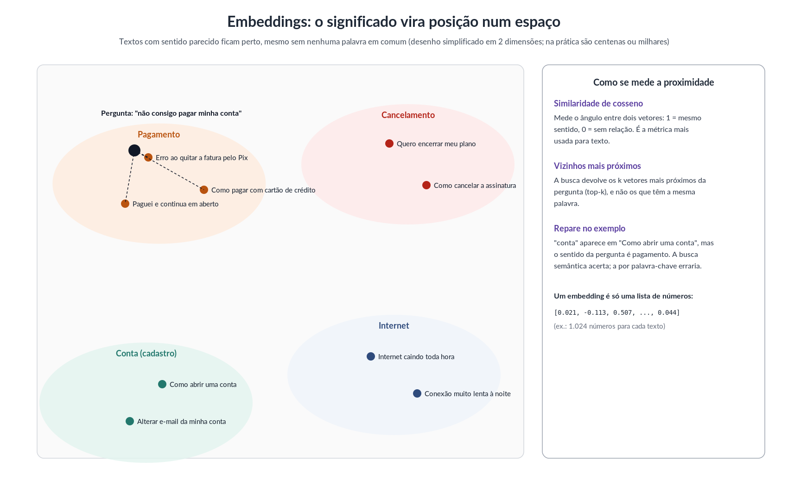
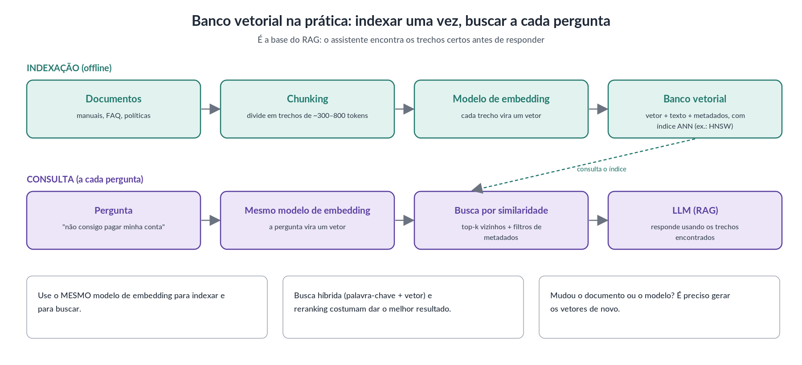

# 10 · Embeddings e bancos vetoriais

Explicação em um parágrafo com uma analogia própria e um exemplo de busca semântica comparada à busca por palavra-chave. Abaixo da entrega, um material de estudo mais aprofundado sobre o tema.

---

## Entrega

### Explicação com analogia

Um embedding é a forma que a IA encontrou de transformar o **significado** de um texto em **números**: um modelo lê a frase e devolve uma lista com centenas ou milhares de valores, que funciona como as coordenadas dessa frase num espaço de significados. É parecido com um projeto no CAD, em que cada peça tem a sua posição definida por coordenadas X, Y e Z e as peças de um mesmo conjunto ficam montadas próximas umas das outras. Com os embeddings acontece o mesmo, só que com muito mais eixos: frases com sentido parecido ficam perto, mesmo usando palavras diferentes, e frases sobre assuntos distintos ficam longe. O banco vetorial é o "almoxarifado" organizado desses pontos: ele guarda milhões de vetores com índices especiais e, quando chega uma pergunta, também transformada em vetor, encontra rapidamente os mais próximos dela. É isso que permite buscar pelo **sentido** do que foi escrito, e não pela coincidência de palavras.

### Exemplo: busca por palavra-chave x busca semântica

**Pergunta do cliente:** "não consigo pagar minha conta"

**Base de conhecimento:**
1. Como abrir uma conta
2. Alterar o e-mail da minha conta
3. Erro ao quitar a fatura pelo Pix
4. Paguei e continua em aberto
5. Como cancelar a assinatura

| | Busca por palavra-chave | Busca semântica (embeddings) |
|---|---|---|
| Como funciona | Procura documentos que contenham as mesmas palavras ("pagar", "conta") | Procura documentos com o **sentido** mais próximo da pergunta |
| Primeiros resultados | "Como abrir uma conta" e "Alterar o e-mail da minha conta" (têm a palavra "conta") | "Erro ao quitar a fatura pelo Pix" e "Paguei e continua em aberto" |
| Acertou? | Não: devolve assuntos de cadastro | Sim: entende que "pagar a conta" = "quitar a fatura" |
| Por quê | "Quitar" e "fatura" não são as palavras da pergunta | O modelo aprendeu que pagar/quitar e conta/fatura têm significados próximos |

A busca por palavra-chave ainda tem seu lugar: para códigos, números de protocolo, nomes próprios e termos exatos, ela é mais precisa. Por isso, em produção, o mais comum é a **busca híbrida**, que combina as duas.

---

## Material de estudo

### 1. O que é um embedding

Um embedding é um **vetor**: uma lista de números (por exemplo, 768, 1.024 ou 3.072 valores) que representa o significado de um texto. Cada número sozinho não quer dizer nada; o que importa é a **posição** do vetor em relação aos outros.



**Como o modelo aprende isso:** modelos de embedding são treinados com milhões de pares de textos. Pares com sentido parecido (pergunta e resposta, frase e paráfrase) são aproximados; pares sem relação são afastados (aprendizado contrastivo). No fim, o modelo "sabe" posicionar qualquer texto novo nesse espaço.

### 2. Como se mede a proximidade

| Métrica | O que mede | Observação |
|---|---|---|
| **Similaridade de cosseno** | O ângulo entre dois vetores (1 = mesmo sentido, 0 = sem relação) | A mais usada para texto |
| **Produto escalar (dot product)** | Ângulo e tamanho dos vetores | Igual ao cosseno quando os vetores são normalizados |
| **Distância euclidiana** | A distância "em linha reta" | Quanto menor, mais parecido |

### 3. O que é um banco vetorial

É um banco de dados feito para guardar vetores e responder rápido à pergunta "**quais vetores estão mais perto deste?**". Comparar a pergunta com milhões de vetores um a um seria lento demais; por isso ele usa índices de **busca aproximada de vizinhos** (ANN, *Approximate Nearest Neighbors*), como o **HNSW**, que troca uma precisão mínima por uma velocidade enorme.

Além do vetor, cada registro guarda o **texto original** e **metadados** (fonte, data, produto, idioma), que servem como filtros: "busque só nos documentos do produto X, atualizados este ano".

Exemplos no mercado: **pgvector** (extensão do PostgreSQL), **Azure AI Search**, **Elasticsearch/OpenSearch** (busca vetorial e híbrida), **Pinecone**, **Weaviate**, **Qdrant**, **Milvus** e **Chroma**.

### 4. Onde isso entra: o fluxo do RAG



1. **Indexação (offline):** os documentos são divididos em trechos (*chunking*), cada trecho vira um vetor e tudo é salvo no banco vetorial.
2. **Consulta (a cada pergunta):** a pergunta vira um vetor com o **mesmo modelo**, o banco devolve os trechos mais próximos (top-k) e o LLM responde usando esses trechos. É a etapa "Selecionar" da engenharia de contexto (atividade 09).

### 5. Exemplo em Python

Ilustração com a biblioteca `sentence-transformers` e um modelo multilíngue gratuito:

```python
from sentence_transformers import SentenceTransformer, util

modelo = SentenceTransformer("paraphrase-multilingual-MiniLM-L12-v2")

documentos = [
    "Como abrir uma conta",
    "Alterar o e-mail da minha conta",
    "Erro ao quitar a fatura pelo Pix",
    "Paguei e continua em aberto",
    "Como cancelar a assinatura",
]
pergunta = "não consigo pagar minha conta"

vet_docs = modelo.encode(documentos, normalize_embeddings=True)
vet_pergunta = modelo.encode(pergunta, normalize_embeddings=True)

similaridades = util.cos_sim(vet_pergunta, vet_docs)[0]
for doc, score in sorted(zip(documentos, similaridades.tolist()), key=lambda x: -x[1]):
    print(f"{score:.2f}  {doc}")
```

Num banco vetorial, a lista `documentos` vira uma tabela com milhões de linhas e a ordenação manual vira uma consulta ao índice.

### 6. Armadilhas comuns

- **Modelos diferentes não conversam:** vetores de um modelo não podem ser comparados com vetores de outro. Trocou o modelo? Gere todos os vetores de novo.
- **Chunking ruim estraga tudo:** trechos grandes demais misturam assuntos; pequenos demais perdem contexto. Uma sobreposição entre trechos (*overlap*) ajuda.
- **Negação e detalhes finos:** "quero cancelar" e "não quero cancelar" podem ficar perto no espaço vetorial. O LLM (ou um reranker) precisa conferir.
- **Termos exatos:** números de pedido, códigos e siglas funcionam melhor com palavra-chave. Daí a busca híbrida.
- **Idioma:** use um modelo que entenda bem português.
- **Documentos desatualizados:** mudou a política? Atualize o vetor, senão o assistente responde com informação velha.

### 7. Busca híbrida e reranking

O padrão mais usado em produção:

1. **Busca por palavra-chave (BM25)** e **busca vetorial** rodam em paralelo.
2. Os resultados são combinados.
3. Um **reranker** (um modelo que lê a pergunta e cada trecho juntos) reordena os melhores candidatos. Um modelo de decisão, como na atividade 07, também pode fazer esse papel.

### 8. Como avaliar

- **Recall@k:** dos trechos certos, quantos aparecem entre os k primeiros resultados?
- **MRR (Mean Reciprocal Rank):** em que posição aparece o primeiro resultado certo?
- Monte um conjunto de perguntas reais com os documentos corretos e teste a cada mudança de modelo, chunking ou índice.

### 9. Vocabulário

| Termo | Significado |
|---|---|
| Embedding | Vetor de números que representa o significado de um texto |
| Dimensão | Quantidade de números do vetor (ex.: 1.024) |
| Similaridade de cosseno | Medida de proximidade pelo ângulo entre vetores |
| Banco vetorial | Banco de dados otimizado para busca por similaridade |
| ANN / HNSW | Busca aproximada de vizinhos e um dos índices mais usados para isso |
| Chunking | Dividir documentos em trechos antes de gerar os vetores |
| Top-k | Os k resultados mais próximos da pergunta |
| Busca híbrida | Combinação de palavra-chave (BM25) com busca vetorial |
| Reranking | Reordenar os candidatos com um modelo mais preciso |

### Fontes

- [Sentence Transformers: documentação](https://www.sbert.net/)
- [pgvector: busca vetorial no PostgreSQL](https://github.com/pgvector/pgvector)
- [Malkov e Yashunin (2016): HNSW, Efficient and robust approximate nearest neighbor search](https://arxiv.org/abs/1603.09320)
- [Reimers e Gurevych (2019): Sentence-BERT](https://arxiv.org/abs/1908.10084)
- [Anthropic: Contextual Retrieval (busca híbrida e reranking em RAG)](https://www.anthropic.com/news/contextual-retrieval)
