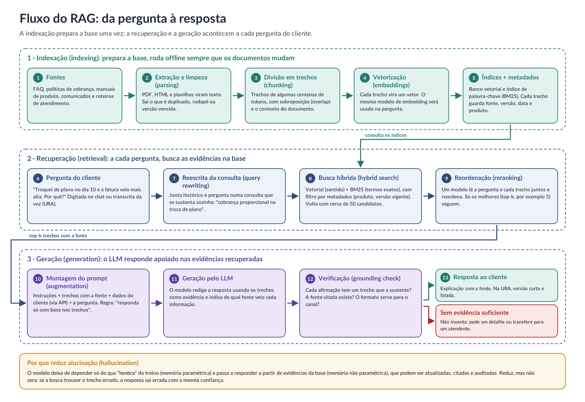
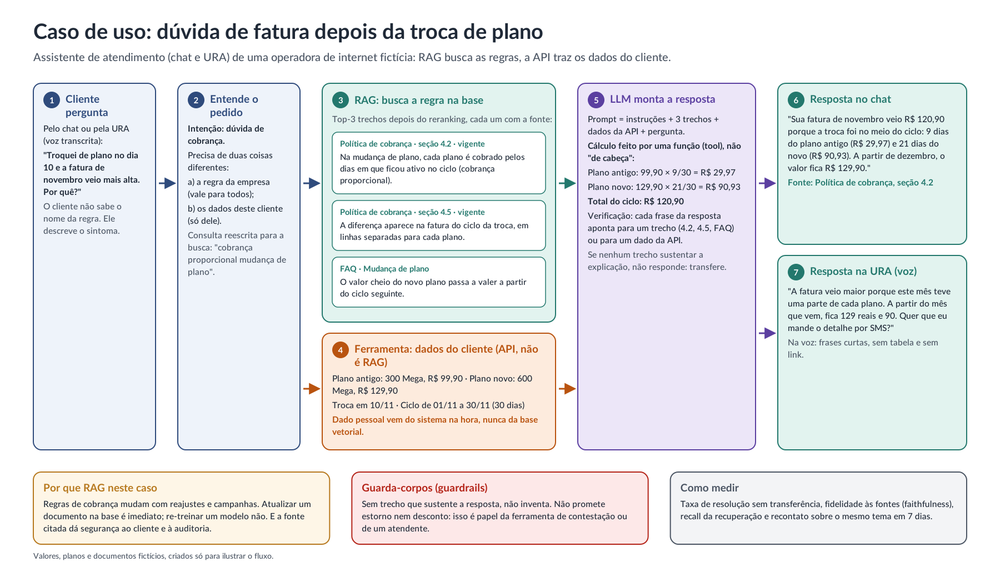
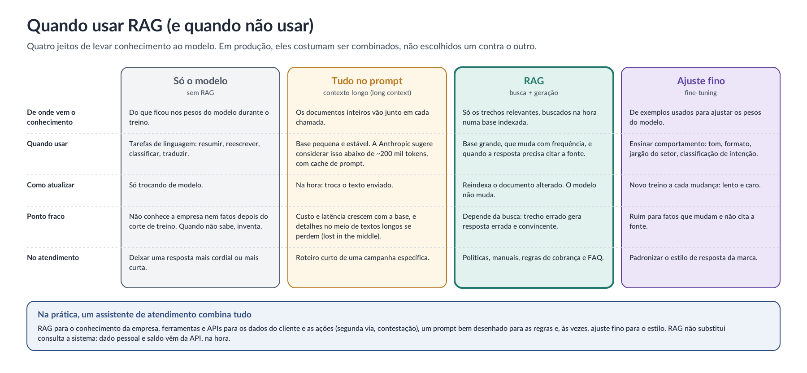
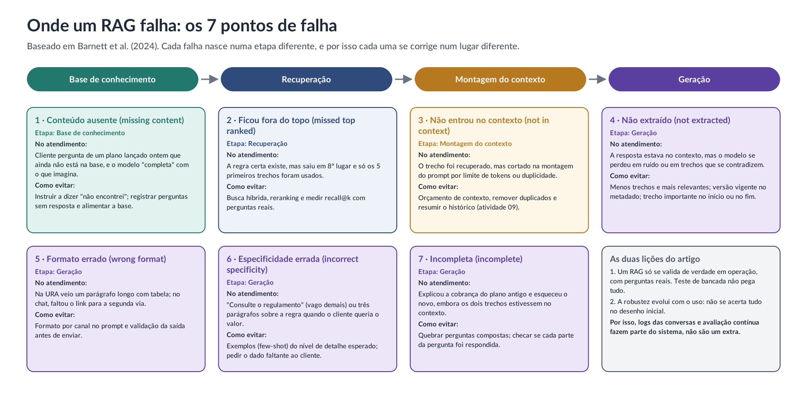

# 11 · RAG (Retrieval-Augmented Generation)

Diagrama do fluxo de RAG, da pergunta à resposta, e um caso de uso detalhado num assistente de atendimento. Abaixo da entrega, um material de estudo mais aprofundado sobre o tema.

---

## Entrega

### 1. Diagrama do fluxo de RAG



O RAG funciona em três tempos:

- **Indexação (offline):** os documentos da empresa são limpos, divididos em trechos, transformados em vetores e guardados em índices com metadados (fonte, versão, data). Isso roda uma vez e de novo sempre que um documento muda.
- **Recuperação (a cada pergunta):** a pergunta do cliente é reescrita numa consulta clara, a busca híbrida (sentido + palavra-chave) traz os candidatos e um reranker escolhe os poucos trechos que realmente respondem.
- **Geração (a cada pergunta):** o LLM recebe as instruções, os trechos com a fonte e a pergunta, e responde **só com base nessas evidências**. Se elas não sustentam uma resposta, ele não inventa: pede mais informação ou transfere.

Na engenharia, ninguém especifica um parafuso "de memória": abre o catálogo do fornecedor na revisão vigente, confere a medida e cita o código na lista de materiais. O RAG obriga o LLM a trabalhar do mesmo jeito: consultar o documento certo antes de responder e mostrar de onde tirou a informação.

### 2. Caso de uso: dúvida de fatura depois da troca de plano



> Empresa, planos, valores e documentos são fictícios, criados só para ilustrar.

**Cenário.** Uma operadora de internet atende pelo chat e pela URA com um assistente de IA generativa. Uma das dúvidas que mais aparecem é: *"troquei de plano e a fatura veio mais alta, por quê?"*. A resposta depende de regras de cobrança que mudam com reajustes, campanhas e novos planos. Hoje, boa parte dessas conversas acaba transferida para um atendente humano só para explicar uma conta que já está escrita na política da empresa.

**Por que RAG resolve.** Um LLM sozinho não conhece a política de cobrança dessa operadora e, quando não sabe, tende a "completar" com algo que parece certo. Colocar todas as políticas no prompt de cada chamada fica caro e lento conforme a base cresce. Re-treinar o modelo a cada reajuste é inviável. Com RAG, a regra fica num documento: mudou a política, atualizo o documento e reindexo, e o assistente passa a responder com a versão nova na hora, citando a fonte.

**O que entra na base de conhecimento.**

| Documento | Exemplo de conteúdo | Metadados importantes |
|---|---|---|
| Política de cobrança | Cobrança proporcional, data de corte, multas | seção, versão, vigência |
| FAQ de planos | O que muda ao trocar de plano | produto, data da revisão |
| Comunicados de reajuste | Novos valores e a partir de quando | data de início, região |
| Roteiros de atendimento | Quando transferir, o que não prometer | canal (chat ou URA) |

**Passo a passo do exemplo.**

1. **Pergunta:** *"Troquei de plano no dia 10 e a fatura de novembro veio mais alta. Por quê?"* O cliente descreve o sintoma; ele não sabe que a regra se chama "cobrança proporcional".
2. **Entendimento:** o assistente identifica uma dúvida de cobrança que precisa de duas coisas diferentes: a **regra** (vale para todos e está nos documentos) e os **dados deste cliente** (só dele, e estão no sistema).
3. **Recuperação (RAG):** a consulta reescrita ("cobrança proporcional mudança de plano") passa pela busca híbrida e pelo reranking. Voltam três trechos: a seção 4.2 (cada plano é cobrado pelos dias em que ficou ativo), a 4.5 (a diferença aparece em linhas separadas na fatura) e a FAQ (o valor cheio do plano novo vale a partir do ciclo seguinte). O filtro de metadados garante que só entram versões **vigentes**.
4. **Dados do cliente (ferramenta, não RAG):** uma chamada de API traz o plano antigo (R$ 99,90), o plano novo (R$ 129,90), a data da troca (10/11) e o ciclo (01 a 30/11). Dado pessoal nunca vai para a base vetorial: vem do sistema, na hora.
5. **Cálculo:** feito por uma função, não pelo modelo "de cabeça": 9 dias do plano antigo (99,90 × 9/30 = R$ 29,97) + 21 dias do novo (129,90 × 21/30 = R$ 90,93) = **R$ 120,90**.
6. **Resposta no chat:** *"Sua fatura de novembro veio R$ 120,90 porque a troca foi no meio do ciclo: 9 dias do plano antigo (R$ 29,97) e 21 dias do novo (R$ 90,93). A partir de dezembro, o valor fica R$ 129,90."* Fonte: Política de cobrança, seção 4.2.
7. **Resposta na URA:** a mesma informação em frases curtas, sem tabela, e com a oferta de mandar o detalhe por SMS.

**Guarda-corpos (guardrails).**

- Se nenhum trecho sustenta a explicação, o assistente diz que não encontrou e transfere. Não inventa regra.
- Não promete estorno, desconto nem prazo: isso é papel da ferramenta de contestação ou de um atendente.
- Documentos vencidos saem do índice (ou ficam marcados e filtrados pela vigência).
- Cada frase da resposta precisa apontar para um trecho ou para um dado da API (verificação de *grounding*).

**Como eu mediria o sucesso.**

| Camada | Métrica | O que mostra |
|---|---|---|
| Recuperação | Recall@k (o trecho certo veio entre os k primeiros?) | Se a busca está achando a regra |
| Geração | Fidelidade às fontes (*faithfulness*) e relevância da resposta | Se o modelo respondeu só com o que estava nos trechos e respondeu o que foi perguntado |
| Negócio | Resolução sem transferência, recontato sobre o mesmo tema em 7 dias, CSAT | Se o cliente entendeu a conta e não precisou voltar |

O caminho seria montar um conjunto de perguntas reais (anonimizadas) com a resposta e o trecho corretos, medir a linha de base antes do piloto e repetir a avaliação a cada mudança de documento, chunking ou modelo.

---

## Material de estudo

### 1. O problema que o RAG resolve

Um LLM guarda o que aprendeu nos próprios pesos. É a **memória paramétrica** (*parametric memory*). Ela tem quatro limites que pesam muito num atendimento:

1. **Data de corte (*knowledge cutoff*):** o modelo não sabe o que aconteceu depois do treino (o reajuste de ontem, o plano lançado nesta semana).
2. **Dados privados:** ele nunca viu a política interna, o manual do produto ou a FAQ da empresa.
3. **Alucinação (*hallucination*):** quando não sabe, ele não fica calado. Gera o texto mais plausível, que pode estar errado e soar convincente.
4. **Sem rastreabilidade (*provenance*):** não dá para perguntar ao modelo "de onde você tirou isso?" e receber uma fonte verificável.

O artigo que deu nome à técnica, de Lewis et al. (2020), resolve isso juntando duas memórias: a paramétrica (o modelo) e uma **memória não paramétrica** (*non-parametric memory*), que é um índice de documentos consultado por um buscador. A grande vantagem prática, já apontada no artigo, é que dá para **atualizar o conhecimento trocando os documentos**, sem re-treinar o modelo.

> Um detalhe histórico que ajuda a entender o nome: no artigo original, o buscador e o gerador eram treinados juntos (*fine-tuning* de ponta a ponta). Hoje, "RAG" virou o nome de um **padrão de arquitetura**: buscar com um sistema de busca e entregar o resultado a um LLM pronto, sem treinar nada. É assim que a Microsoft e a AWS descrevem o padrão nas suas documentações.

### 2. Como funciona por dentro

#### 2.1 Indexação (*indexing*)

| Etapa | O que acontece | Decisões que importam |
|---|---|---|
| **Coleta** (*ingestion*) | Conecta as fontes: repositório de arquivos, wiki, base de FAQ | Quais fontes são oficiais? Quem é o dono de cada uma? |
| **Extração** (*parsing*) | PDF, HTML, Word e planilhas viram texto | Tabelas e imagens precisam de tratamento próprio (OCR, extração de tabela) |
| **Divisão em trechos** (*chunking*) | O texto é cortado em pedaços de algumas centenas de tokens | Tamanho, sobreposição (*overlap*) e onde cortar (por seção, por parágrafo, por significado) |
| **Vetorização** (*embedding*) | Cada trecho vira um vetor (atividade 10) | Modelo de embedding que entenda português |
| **Indexação** | Vetores vão para o banco vetorial; o texto vai para um índice de palavra-chave (BM25) | Metadados: fonte, seção, versão, vigência, produto, canal |

**Estratégias de chunking mais usadas:**

- **Tamanho fixo** (*fixed-size*): simples, mas pode cortar uma regra no meio.
- **Por estrutura** (seção, título, parágrafo): respeita o jeito que o documento foi escrito. Costuma ser a melhor escolha para políticas e manuais.
- **Semântico** (*semantic chunking*): corta onde o assunto muda, medindo a similaridade entre frases vizinhas.
- **Hierárquico** (*parent-child*): busca com trechos pequenos (mais precisos) e entrega ao modelo o trecho "pai", maior (mais contexto). O Amazon Bedrock Knowledge Bases oferece essa opção, com tamanhos configuráveis para pai e filho.

Um trecho de base bem indexado fica mais ou menos assim:

```json
{
  "id": "cob-4.2",
  "texto": "Na mudança de plano, cada plano é cobrado pelos dias em que ficou ativo no ciclo.",
  "contexto": "Política de cobrança, seção 4 (Mudanças de plano). Trata do cálculo proporcional da fatura.",
  "metadados": {
    "fonte": "Política de cobrança",
    "secao": "4.2",
    "versao": "2026-10",
    "vigente": true,
    "produto": "banda larga",
    "canal": ["chat", "ura"]
  },
  "vetor": [0.021, -0.113, 0.087, "..."]
}
```

#### 2.2 Recuperação (*retrieval*)

1. **Reescrita da consulta** (*query rewriting*): numa conversa, a pergunta "e no outro plano?" não faz sentido sozinha. Um passo antes da busca junta o histórico e reescreve a pergunta como uma consulta completa. Também dá para quebrar uma pergunta composta em várias consultas.
2. **Busca híbrida** (*hybrid search*): a busca vetorial acha trechos de **sentido** parecido ("pagar a conta" ≈ "quitar a fatura"); o **BM25** acha **termos exatos** (código de erro, nome de plano, número de protocolo). Os dois rankings são combinados. Uma forma comum é a *Reciprocal Rank Fusion* (RRF), que soma pontos pela posição de cada trecho em cada lista.
3. **Filtro por metadados:** "só versões vigentes", "só do produto banda larga", "só o que vale para a URA". Isso evita a resposta certa para o produto errado.
4. **Reordenação** (*reranking*): um modelo mais caro lê a pergunta e cada candidato juntos e dá uma nota de relevância. Busca-se um conjunto grande (dezenas ou centenas) e só os melhores seguem para o LLM.

#### 2.3 Geração (*generation*)

O prompt é montado com blocos bem delimitados (atividades 08 e 09):

```text
Você é o assistente de atendimento de uma operadora de internet.
Responda SOMENTE com base nos <trechos> e nos <dados_cliente> abaixo.
Se eles não forem suficientes, diga que não encontrou a informação
e ofereça transferir para um atendente. Não prometa estorno nem desconto.
Ao final de cada afirmação, cite o id do trecho entre colchetes.

<trechos>
  <trecho id="cob-4.2" fonte="Política de cobrança, seção 4.2">...</trecho>
  <trecho id="cob-4.5" fonte="Política de cobrança, seção 4.5">...</trecho>
</trechos>
<dados_cliente>...</dados_cliente>
<pergunta>Troquei de plano no dia 10 e a fatura veio mais alta. Por quê?</pergunta>
```

Depois da geração, uma **verificação** confere se as citações existem, se cada afirmação tem um trecho que a sustente e se o formato serve para o canal. Isso pode ser uma regra simples (o id citado existe?) ou um segundo modelo atuando como juiz (*LLM-as-a-judge*).

### 3. Por que reduz alucinação, e por que não zera

O RAG muda a tarefa do modelo: em vez de "lembrar" a resposta, ele passa a **ler e resumir uma evidência** que está na frente dele. Isso reduz bastante a invenção e ainda dá a fonte para conferir.

Mas não zera. Um estudo de Stanford (Magesh et al., 2024/2025) avaliou ferramentas jurídicas comerciais baseadas em RAG, vendidas como "livres de alucinação". Elas erraram menos que um chatbot genérico, mas ainda **alucinaram em mais de 17% das consultas**. Os motivos são os pontos de falha da seção 7: a busca traz o trecho errado, o trecho certo fica de fora ou o modelo interpreta mal o que leu.

**A lição para o dia a dia:** RAG é uma redução de risco, não uma garantia. Por isso existem a verificação, o "não encontrei" como resposta válida e a avaliação contínua.

### 4. Quando usar RAG (e quando não usar)



Três regras práticas:

- **Base pequena e estável?** Talvez nem precise de RAG. A Anthropic sugere que, abaixo de uns 200 mil tokens (centenas de páginas), vale testar colocar tudo no prompt e usar *prompt caching* para baratear.
- **Conhecimento que muda e precisa de fonte?** RAG.
- **Comportamento (tom, formato, jargão)?** Prompt bem escrito primeiro; *fine-tuning* só se o prompt não der conta. Fine-tuning ensina "como responder", não "o que é verdade hoje".

E um ponto que confunde muito: **dado do cliente não é RAG.** Saldo, status do pedido e plano contratado vêm de uma ferramenta (API), na hora. Indexar dado pessoal numa base vetorial cria problema de LGPD, de controle de acesso e de informação desatualizada.

### 5. Na prática: um RAG mínimo em Python

Código **ilustrativo** (não executado aqui), só para mostrar as peças. Usa `sentence-transformers` para os vetores e `rank_bm25` para a busca por palavra-chave, e combina os dois rankings com RRF.

```python
from rank_bm25 import BM25Okapi
from sentence_transformers import SentenceTransformer, util

trechos = [
    {"id": "cob-4.2", "fonte": "Política de cobrança, seção 4.2",
     "texto": "Na mudança de plano, cada plano é cobrado pelos dias em que ficou ativo no ciclo."},
    {"id": "cob-4.5", "fonte": "Política de cobrança, seção 4.5",
     "texto": "A diferença aparece na fatura do ciclo da troca, em linhas separadas para cada plano."},
    {"id": "faq-12", "fonte": "FAQ, Mudança de plano",
     "texto": "O valor cheio do novo plano passa a valer a partir do ciclo seguinte."},
    {"id": "seg-2.1", "fonte": "Manual de segunda via, seção 2.1",
     "texto": "A segunda via pode ser emitida pelo app ou pelo chat, com o CPF do titular."},
]

# 1. Indexação: vetores (sentido) + BM25 (termos exatos)
modelo = SentenceTransformer("paraphrase-multilingual-MiniLM-L12-v2")
vetores = modelo.encode([t["texto"] for t in trechos], normalize_embeddings=True)
bm25 = BM25Okapi([t["texto"].lower().split() for t in trechos])


# 2. Recuperação: busca híbrida com Reciprocal Rank Fusion
def buscar(consulta, k=3, k_rrf=60):
    sim = util.cos_sim(modelo.encode(consulta, normalize_embeddings=True), vetores)[0].tolist()
    rank_vetorial = sorted(range(len(trechos)), key=lambda i: -sim[i])

    notas_bm25 = bm25.get_scores(consulta.lower().split())
    rank_bm25 = sorted(range(len(trechos)), key=lambda i: -notas_bm25[i])

    pontos = {i: 0.0 for i in range(len(trechos))}
    for ranking in (rank_vetorial, rank_bm25):
        for posicao, i in enumerate(ranking):
            pontos[i] += 1 / (k_rrf + posicao + 1)

    melhores = sorted(pontos, key=lambda i: -pontos[i])[:k]
    return [trechos[i] for i in melhores]


# 3. Geração: monta o prompt com os trechos e a fonte
def montar_prompt(pergunta, evidencias, dados_cliente):
    blocos = "\n".join(
        f'  <trecho id="{e["id"]}" fonte="{e["fonte"]}">{e["texto"]}</trecho>' for e in evidencias
    )
    return (
        "Responda SOMENTE com base nos trechos e nos dados do cliente.\n"
        "Se não forem suficientes, diga que não encontrou e ofereça transferir.\n"
        "Cite o id do trecho entre colchetes.\n\n"
        f"<trechos>\n{blocos}\n</trechos>\n"
        f"<dados_cliente>{dados_cliente}</dados_cliente>\n"
        f"<pergunta>{pergunta}</pergunta>"
    )


evidencias = buscar("cobrança proporcional na troca de plano")
prompt = montar_prompt(
    "Troquei de plano no dia 10 e a fatura veio mais alta. Por quê?",
    evidencias,
    {"plano_antigo": 99.90, "plano_novo": 129.90, "troca": "10/11", "ciclo": "01/11 a 30/11"},
)
# o prompt segue para o LLM (Bedrock, Azure OpenAI, API da Anthropic etc.)
```

Num projeto real, os trechos vêm de um banco vetorial (atividade 10), o `split()` dá lugar a um tokenizador que trate acentos e plurais do português, e entra um reranker entre a busca e o prompt. Serviços gerenciados como o **Amazon Bedrock Knowledge Bases** e o **Azure AI Search** já entregam indexação, busca e montagem do prompt prontos; o trabalho passa a ser configurar bem e avaliar.

### 6. Técnicas que separam o júnior do profissional

| Técnica | Problema que resolve | Ideia |
|---|---|---|
| **Recuperação contextual** (*contextual retrieval*) | Trecho solto perde o contexto ("a receita cresceu 3%": de qual empresa? de quando?) | Antes de indexar, um LLM escreve uma frase de contexto (50 a 100 tokens) e cola no início de cada trecho |
| **Busca híbrida** | Embedding não acha código exato; BM25 não entende sinônimo | Usar os dois e combinar |
| **Reranking** | Os primeiros resultados da busca nem sempre são os melhores | Buscar muitos, reordenar com um modelo mais preciso, mandar poucos |
| **Chunking hierárquico** | Trecho pequeno é preciso, mas sem contexto; trecho grande dilui a busca | Buscar no pequeno, entregar o grande |
| **Filtro por metadados e versão** | Resposta certa com regra vencida | Indexar vigência e filtrar sempre |
| **Recuperação agêntica** (*agentic retrieval*) | Pergunta complexa que exige várias buscas | Um agente planeja, quebra a pergunta e decide onde e quantas vezes buscar. A Microsoft já recomenda esse caminho para novas soluções no Azure AI Search |

Sobre números: no teste da própria Anthropic, a recuperação contextual reduziu a taxa de falha na busca (o trecho certo fora do top-20) de 5,7% para 3,7%; somando BM25 contextual, para 2,9%; e com reranking, para 1,9% (67% menos falhas). **São números do fornecedor, medidos nas bases dele**: servem de direção, não de promessa. O ganho real só aparece medindo na sua própria base.

### 7. Onde o RAG falha (armadilhas)



O artigo de Barnett et al. (2024) analisou três sistemas RAG reais e catalogou sete pontos de falha. As duas conclusões dele valem ouro: **um RAG só se valida de verdade em operação** e **a robustez evolui com o uso**, não nasce pronta no desenho.

Outras armadilhas comuns:

- **Lixo entra, lixo sai:** documento desatualizado ou contraditório na base vira resposta errada com fonte "oficial".
- **Tabelas e PDFs escaneados:** se a extração estraga a tabela de preços, o modelo lê números trocados.
- **Trecho no meio de muitos trechos:** modelos usam melhor o começo e o fim do contexto (*lost in the middle*, Liu et al., 2023). Mandar 30 trechos "por garantia" piora.
- **Top-k fixo para tudo:** pergunta simples precisa de 2 trechos; pergunta comparativa, de mais.
- **Sem "não sei":** se o prompt não autoriza o modelo a dizer que não encontrou, ele preenche o vazio.
- **Dado pessoal na base vetorial:** risco de vazamento entre clientes e de LGPD. Dado pessoal vem por API com controle de acesso.
- **Controle de acesso ignorado:** se a base mistura documentos internos e públicos, o filtro de permissão tem que acontecer **na busca**, antes de o trecho chegar ao modelo.
- **Injeção de prompt indireta:** um documento indexado pode conter texto do tipo "ignore as instruções". Trechos recuperados são **dados**, não ordens, e o prompt deve deixar isso claro.

### 8. Como medir

Um RAG tem duas peças, e cada uma se mede separado. Se a resposta está errada, primeiro descubro **se a busca trouxe o trecho certo**. Só depois olho para o modelo.

| Peça | Métrica | Pergunta que responde |
|---|---|---|
| Recuperação | **Recall@k** | O trecho certo veio entre os k primeiros? |
| Recuperação | **MRR** | Em que posição veio o primeiro trecho certo? |
| Recuperação | **Precisão de contexto** (*context precision*) | Os trechos relevantes estão no topo, ou há muito ruído? |
| Recuperação | **Cobertura de contexto** (*context recall*) | O que a resposta ideal precisa está nos trechos recuperados? |
| Geração | **Fidelidade** (*faithfulness*) | Das afirmações da resposta, quantas são sustentadas pelos trechos? |
| Geração | **Relevância da resposta** (*answer relevance*) | A resposta responde ao que foi perguntado? |
| Negócio | Resolução sem transferência, recontato, CSAT, tempo de atendimento | O cliente saiu resolvido? |

As quatro métricas de contexto e geração vêm do **RAGAS** (Es et al., 2023), um framework que usa um LLM como avaliador e não exige que um humano escreva a resposta de referência para todas elas. **Boas práticas de avaliação:**

1. Montar um **conjunto de referência** (*golden set*) com perguntas reais, anonimizadas, incluindo perguntas **sem resposta na base** (para testar o "não encontrei").
2. Rodar a avaliação a cada mudança de chunking, modelo de embedding, reranker, prompt ou modelo.
3. **Calibrar o juiz:** conferir uma amostra das notas do LLM avaliador com avaliação humana antes de confiar nele.
4. Em produção, acompanhar as perguntas que terminam em "não encontrei" ou em transferência: elas mostram o que falta na base.

### 9. Conexão com as outras atividades e com os meus projetos

- **05 · Tokens e janela de contexto:** o RAG existe porque a janela é finita e cara. Ele decide **o que** entra nela.
- **08 · Engenharia de prompt:** as instruções de "responda só com base nos trechos" e "cite a fonte" são engenharia de prompt pura.
- **09 · Engenharia de contexto:** o RAG é a principal ferramenta da etapa "selecionar" do contexto.
- **10 · Embeddings e bancos vetoriais:** a recuperação vetorial do RAG é exatamente aquela busca semântica. A atividade 10 é a peça; esta é a máquina montada.
- **07 · Modelos de decisão:** o reranking é um modelo de decisão aplicado à pergunta "qual trecho responde melhor?".
- **AlphaGen Daily:** meu agente serverless já usa o Amazon Bedrock. O passo natural para ele responder com base em documentos próprios seria conectar um Bedrock Knowledge Base, que entrega a indexação e a recuperação gerenciadas.

### 10. Vocabulário

| Termo | Significado |
|---|---|
| RAG (*Retrieval-Augmented Generation*) | Padrão em que o LLM responde a partir de trechos buscados numa base, e não só do que aprendeu no treino |
| Memória paramétrica | O conhecimento guardado nos pesos do modelo |
| Memória não paramétrica | O conhecimento guardado fora do modelo, numa base consultável |
| Indexação (*indexing*) | Preparar a base: extrair, dividir, vetorizar e guardar os trechos |
| Chunking | Dividir documentos em trechos |
| Overlap | Sobreposição entre trechos vizinhos, para não cortar uma ideia no meio |
| Recuperação (*retrieval*) | Buscar os trechos relevantes para a pergunta |
| Busca híbrida (*hybrid search*) | Busca vetorial + busca por palavra-chave (BM25) |
| BM25 | Algoritmo clássico de ranking por palavra-chave, evolução do TF-IDF |
| RRF (*Reciprocal Rank Fusion*) | Forma de combinar rankings somando pontos pela posição |
| Reranking | Reordenar os candidatos com um modelo mais preciso |
| Top-k | Os k trechos mais bem colocados que seguem para o modelo |
| Grounding | Ancorar a resposta em evidências verificáveis |
| Faithfulness | Quanto da resposta é sustentado pelos trechos recuperados |
| Contextual retrieval | Acrescentar a cada trecho uma frase de contexto antes de indexar |
| Agentic retrieval | Um agente decide como, onde e quantas vezes buscar |
| Golden set | Conjunto de perguntas com respostas e trechos corretos, usado para avaliar |

### Fontes

- [Lewis et al. (2020): Retrieval-Augmented Generation for Knowledge-Intensive NLP Tasks](https://arxiv.org/abs/2005.11401)
- [Anthropic: Introducing Contextual Retrieval](https://www.anthropic.com/news/contextual-retrieval)
- [AWS: How Amazon Bedrock knowledge bases work](https://docs.aws.amazon.com/bedrock/latest/userguide/kb-how-it-works.html)
- [AWS: How content chunking works for knowledge bases](https://docs.aws.amazon.com/bedrock/latest/userguide/kb-chunking.html)
- [Microsoft Learn: Retrieval Augmented Generation (RAG) in Azure AI Search](https://learn.microsoft.com/azure/search/retrieval-augmented-generation-overview)
- [Microsoft Learn: Retrieval augmented generation (RAG) and indexes](https://learn.microsoft.com/azure/foundry/concepts/retrieval-augmented-generation)
- [Es et al. (2023): Ragas, Automated Evaluation of Retrieval Augmented Generation](https://arxiv.org/abs/2309.15217)
- [Barnett et al. (2024): Seven Failure Points When Engineering a Retrieval Augmented Generation System](https://arxiv.org/abs/2401.05856)
- [Liu et al. (2023): Lost in the Middle, How Language Models Use Long Contexts](https://arxiv.org/abs/2307.03172)
- [Magesh et al. (2024): Hallucination-Free? Assessing the Reliability of Leading AI Legal Research Tools](https://arxiv.org/abs/2405.20362)
