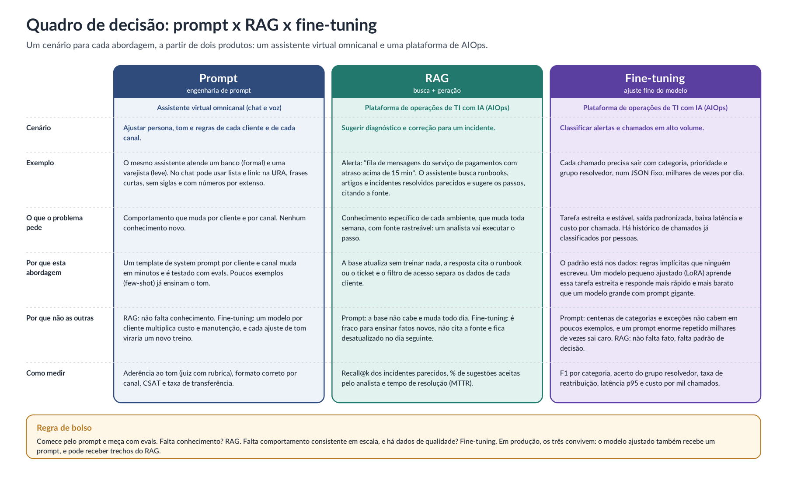
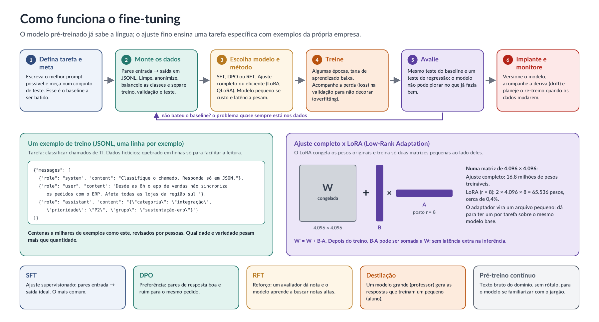
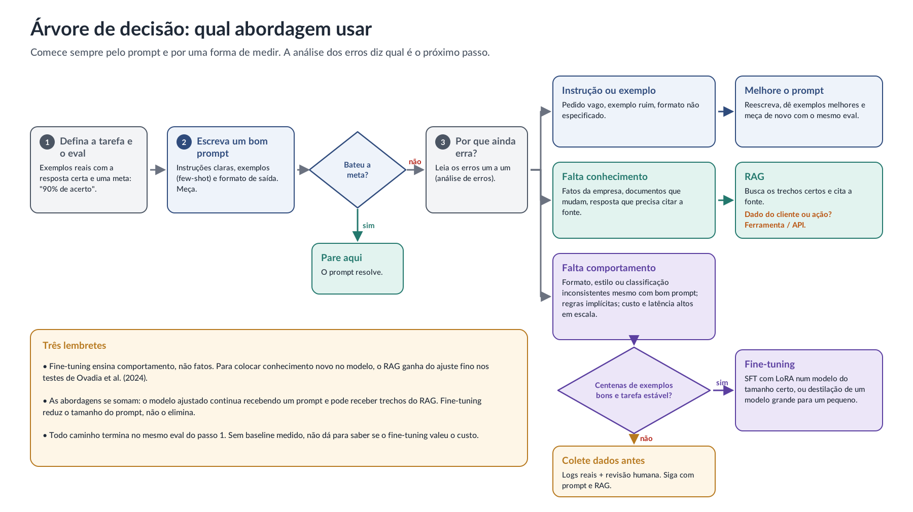

# 12 · Fine-tuning

Quadro de decisão "prompt x RAG x fine-tuning", com um cenário para cada abordagem e a justificativa da escolha. Abaixo da entrega, um material de estudo mais aprofundado sobre o tema.

---

## Entrega

### Quadro de decisão



Os cenários partem de dois tipos de produto com que trabalho: um **assistente virtual omnicanal** (chat e voz, com IA generativa) e uma **plataforma de operações de TI com IA** (AIOps: monitoramento, triagem e resposta a incidentes). Os cenários são hipotéticos e os exemplos são genéricos.

| | Prompt | RAG | Fine-tuning |
|---|---|---|---|
| **Produto** | Assistente virtual omnicanal | Plataforma de AIOps | Plataforma de AIOps |
| **Cenário** | Ajustar persona, tom e regras de cada cliente e de cada canal | Sugerir diagnóstico e correção para um incidente | Classificar alertas e chamados em alto volume |
| **O que o problema pede** | Comportamento que muda por cliente e por canal, sem conhecimento novo | Conhecimento de cada ambiente, que muda toda semana, com fonte rastreável | Tarefa estreita e estável, saída padronizada, baixa latência e custo por chamada |
| **Por que esta abordagem** | Muda em minutos, um template por cliente e canal, testado com evals | A base atualiza sem treino, a resposta cita o runbook e o acesso fica separado por cliente | O padrão está nos dados históricos; um modelo pequeno ajustado faz a tarefa mais rápido e mais barato |
| **Por que não as outras** | Não falta conhecimento; um modelo ajustado por cliente seria caro de manter | O prompt não comporta a base; fine-tuning não é bom para fatos que mudam e não cita a fonte | Centenas de categorias não cabem em poucos exemplos; não falta fato, falta padrão de decisão |
| **Como medir** | Aderência ao tom, formato por canal, CSAT | Recall@k, % de sugestões aceitas, MTTR | F1 por categoria, taxa de reatribuição, latência, custo |

### Justificativa de cada escolha

**1. Prompt: persona e tom por cliente e por canal (assistente omnicanal).**
O mesmo assistente atende um banco, que pede linguagem formal, e uma varejista, que prefere um tom leve. No chat ele pode mandar lista e link; na URA, a resposta precisa de frases curtas, sem siglas e com números por extenso, porque vai virar voz. Nada disso é conhecimento novo: é **comportamento**, e comportamento que muda. Um system prompt em forma de template (com variáveis de cliente e canal) e alguns exemplos de resposta resolvem, e a mudança de tom pedida numa reunião de segunda-feira está no ar na terça. Fazer fine-tuning aqui seria como fabricar um molde novo cada vez que o cliente quer mudar a cor da peça: o molde é o mesmo, muda só a pintura.

**2. RAG: diagnóstico de incidente (plataforma de AIOps).**
Chega o alerta "fila de mensagens do serviço de pagamentos com atraso acima de 15 minutos". Para sugerir o que fazer, o assistente precisa de conhecimento **daquele ambiente**: o runbook do serviço, os artigos da base de conhecimento e os incidentes parecidos que já foram resolvidos. Esse conhecimento muda toda semana, cada cliente tem o seu e quem vai executar a correção é um analista, que precisa ver de onde veio a sugestão antes de mexer em produção. É exatamente o problema que o RAG resolve: buscar, citar e atualizar sem re-treinar. Colocar isso dentro do modelo com fine-tuning seria pior em tudo: o modelo aprende fatos novos com dificuldade, não diz a fonte, fica desatualizado no dia seguinte e ainda mistura dados de clientes diferentes nos mesmos pesos.

**3. Fine-tuning: classificação de chamados e alertas (plataforma de AIOps).**
Cada chamado precisa sair com categoria, prioridade e grupo resolvedor, num JSON fixo, milhares de vezes por dia. O conhecimento para isso não está num documento: está no **histórico**, em milhares de chamados que analistas já classificaram, com regras que ninguém escreveu ("quando fala em sincronização com o ERP e cita mais de uma loja, é P2 e vai para a sustentação do ERP"). Um prompt com poucos exemplos não dá conta de centenas de categorias e das exceções de cada cliente, e um prompt enorme repetido milhares de vezes por dia pesa no custo e na latência. Aqui o fine-tuning faz sentido: um modelo pequeno, ajustado com LoRA nesses exemplos, aprende o padrão da tarefa e responde rápido e barato. Os cuidados são dois: o histórico precisa ser bom (se os chamados foram mal classificados, o modelo aprende o erro) e o modelo ajustado tem que **vencer**, no mesmo teste, um baseline com prompt e exemplos.

**Na prática, as três se somam.** O classificador ajustado continua recebendo um prompt curto; o assistente de incidentes pode usar a categoria que o classificador gerou como filtro na busca do RAG; e o assistente omnicanal usa prompt para o tom, RAG para a FAQ do cliente e ferramentas para os dados de cada pessoa. A pergunta certa não é "qual das três?", e sim "qual problema cada uma resolve neste fluxo?".

---

## Material de estudo

### 1. O problema que o fine-tuning resolve

Um LLM passa por fases de treino:

1. **Pré-treino** (*pre-training*): aprende a língua e o mundo lendo uma quantidade enorme de texto, prevendo o próximo token.
2. **Ajuste por instruções e alinhamento** (*instruction tuning* e *RLHF*): aprende a seguir pedidos e conversar. É o modelo que usamos pela API.
3. **Ajuste fino** (*fine-tuning*): o passo que **nós** podemos dar. Continuamos o treino com exemplos próprios para especializar o modelo numa tarefa.

A analogia que mais me ajuda: o modelo pré-treinado é um engenheiro recém-formado. Ele sabe física, desenho técnico e materiais, mas não conhece o padrão de projeto da empresa. O **prompt** é a ordem de serviço bem escrita. O **RAG** é o catálogo e as normas na mesa dele. O **fine-tuning** são os três meses de experiência no setor: ele passa a fazer do jeito da casa sem precisar ler o manual a cada peça. Mas a experiência não substitui o catálogo: a medida do parafuso ele continua consultando.

O fine-tuning resolve problemas que o prompt não resolve bem:

- **Consistência:** formato, estilo ou rótulos que precisam sair iguais em milhares de chamadas.
- **Regras implícitas:** padrões que existem nos dados mas ninguém consegue escrever num prompt.
- **Custo e latência:** um modelo menor ajustado pode fazer uma tarefa estreita tão bem quanto um grande, com um prompt bem mais curto.
- **Tarefas em que o modelo base falha** mesmo com bons exemplos (casos de borda, jargão do setor).

E **não** resolve bem: ensinar fatos novos, manter informação atualizada ou mostrar a fonte. Para isso existe o RAG (atividade 11).

### 2. Como funciona por dentro



O treino em si é o mesmo mecanismo do pré-treino, em escala muito menor:

1. O modelo recebe a entrada de um exemplo e gera a saída.
2. A saída é comparada com a resposta esperada, e o erro é medido (a perda, *loss*).
3. O algoritmo calcula em que direção cada peso deveria se mover para errar menos (*gradiente*) e dá um passo pequeno nessa direção.
4. Isso se repete para todos os exemplos, por algumas passadas completas (*épocas*, *epochs*).

Três parâmetros mandam no resultado:

| Parâmetro | O que controla | Erro comum |
|---|---|---|
| **Taxa de aprendizado** (*learning rate*) | O tamanho de cada passo | Alta demais apaga o que o modelo sabia; baixa demais não aprende |
| **Épocas** (*epochs*) | Quantas vezes o modelo vê os dados | Muitas épocas fazem o modelo decorar os exemplos (*overfitting*) |
| **Divisão dos dados** | Treino, validação e teste separados | Exemplo do teste vazando para o treino dá uma nota falsa |

O sinal de alerta clássico: a perda no **treino** continua caindo, mas a perda na **validação** para de cair ou sobe. É a hora de parar.

### 3. Tipos de ajuste

| Tipo | Dado necessário | Quando usar |
|---|---|---|
| **SFT** (*supervised fine-tuning*) | Pares entrada → saída ideal | Formato, estilo, classificação, extração. O mais comum |
| **DPO** (*direct preference optimization*) | Pares de resposta preferida e não preferida | Quando é mais fácil dizer "esta é melhor que aquela" do que escrever a resposta ideal |
| **RFT** (*reinforcement fine-tuning*) | Prompts + um avaliador que dá nota | Tarefas complexas com resposta verificável |
| **Destilação** (*distillation*) | Prompts; o modelo grande gera as respostas | Levar a qualidade de um modelo grande para um pequeno, mais barato |
| **Pré-treino contínuo** (*continued pre-training*) | Texto bruto do domínio, sem rótulo | Familiarizar o modelo com o vocabulário de um setor |

A OpenAI descreve esses métodos assim: o SFT usa pares de entrada e saída para ajustar os parâmetros, e o RFT usa aprendizado por reforço com uma nota dada por um avaliador. Na AWS, o Amazon Bedrock oferece fine-tuning supervisionado, por reforço, destilação e pré-treino contínuo. Na destilação, o Bedrock gera as respostas com o modelo "professor" e usa essas respostas para ajustar o "aluno".

> **O mercado está se movendo.** Em 2026, a OpenAI começou a encerrar a plataforma de fine-tuning dela: ela já não aceita novos usuários, e os modelos ajustados continuam disponíveis até o modelo base ser descontinuado. O fine-tuning continua forte nas nuvens (Bedrock, Azure, Vertex) e, principalmente, em modelos abertos. A lição é prática: um modelo ajustado depende do modelo base, e quando a base é aposentada é preciso treinar de novo.

### 4. Ajuste completo x ajuste eficiente (LoRA e QLoRA)

No **ajuste completo** (*full fine-tuning*), todos os pesos do modelo são atualizados. Isso é caro para treinar, e cada versão ajustada é uma cópia inteira do modelo.

O **LoRA** (*Low-Rank Adaptation*) mudou o jogo: os pesos originais ficam **congelados**, e o treino acontece só em duas matrizes pequenas acopladas a cada camada. Segundo o artigo original, para o GPT-3 175B o LoRA reduziu em 10.000 vezes o número de parâmetros treináveis e em 3 vezes a memória de GPU, com qualidade igual ou melhor que o ajuste completo e sem latência extra na inferência.

O **QLoRA** (Dettmers et al., 2023) vai além: carrega o modelo base comprimido em 4 bits (*quantização*) e treina os adaptadores LoRA em cima. Isso permite ajustar modelos grandes numa única GPU.

A consequência prática para uma empresa que atende vários clientes: dá para ter **um modelo base e vários adaptadores pequenos**, um por tarefa ou por cliente, trocados na hora de servir. É como ter um único torno com vários jogos de ferramentas: a máquina é a mesma, muda o ferramental.

### 5. Quando faz sentido (e quando não faz)



A Microsoft resume a ordem: **comece avaliando o modelo base com prompt e RAG para ter uma linha de base**, e só considere fine-tuning se conseguir mostrar que já explorou essas abordagens e onde elas falham. A AWS faz o alerta pelos dois lados: tem time que pula direto para o fine-tuning quando um prompt bem feito resolveria o problema numa tarde, e tem time que passa semanas preso no prompt quando o caso claramente pede dados de treino.

**Sinais de que o fine-tuning pode valer a pena:**

- Você tem um baseline com prompt (e RAG, se for o caso) medido, e sabe exatamente onde ele erra.
- Os erros são de **comportamento** (formato, estilo, rótulo), não de **conhecimento**.
- Existem centenas ou milhares de exemplos de qualidade, e a tarefa é estável.
- O volume é alto o bastante para que custo e latência por chamada importem.

**Sinais de que não vale:**

- O problema é falta de informação ou informação que muda: é RAG.
- O comportamento muda com frequência (tom de campanha, regra do mês): é prompt.
- Não há dados confiáveis, ou os rótulos do histórico são ruins.
- Ninguém mediu o baseline. Sem ele, não há como saber se o treino valeu o custo.

Sobre conhecimento, há evidência direta: o estudo de Ovadia et al. (2024) comparou fine-tuning e RAG para "injetar" conhecimento num LLM. O fine-tuning não supervisionado trouxe alguma melhora, mas **o RAG foi melhor em todos os casos**, tanto para conhecimento que o modelo já tinha visto quanto para conhecimento totalmente novo. Os autores também viram que os LLMs têm dificuldade para aprender fatos novos por fine-tuning.

### 6. Na prática: ajuste com LoRA em Python

Código **ilustrativo** (não executado aqui), no ecossistema Hugging Face (`transformers`, `peft` e `trl`). A tarefa é o classificador de chamados do cenário 3.

**Dados (`treino.jsonl`, um exemplo por linha):**

```json
{"messages": [{"role": "system", "content": "Classifique o chamado. Responda só em JSON."}, {"role": "user", "content": "Desde as 8h o app de vendas não sincroniza os pedidos com o ERP. Afeta todas as lojas da região sul."}, {"role": "assistant", "content": "{\"categoria\": \"integração\", \"prioridade\": \"P2\", \"grupo\": \"sustentação-erp\"}"}]}
{"messages": [{"role": "system", "content": "Classifique o chamado. Responda só em JSON."}, {"role": "user", "content": "Usuário esqueceu a senha do e-mail corporativo."}, {"role": "assistant", "content": "{\"categoria\": \"acesso\", \"prioridade\": \"P4\", \"grupo\": \"service-desk\"}"}]}
```

**Treino com LoRA:**

```python
from datasets import load_dataset
from peft import LoraConfig
from trl import SFTConfig, SFTTrainer

dados = load_dataset(
    "json",
    data_files={"train": "treino.jsonl", "validation": "validacao.jsonl"},
)

# LoRA: congela o modelo base e treina adaptadores de posto 8
lora = LoraConfig(
    r=8,
    lora_alpha=16,
    lora_dropout=0.05,
    target_modules="all-linear",
    task_type="CAUSAL_LM",
)

config = SFTConfig(
    output_dir="classificador-chamados-lora",
    num_train_epochs=3,
    learning_rate=2e-4,
    per_device_train_batch_size=8,
    eval_strategy="epoch",   # mede a perda na validação a cada época
    logging_steps=20,
)

trainer = SFTTrainer(
    model="Qwen/Qwen2.5-1.5B-Instruct",   # um modelo pequeno (SLM), como na atividade 06
    train_dataset=dados["train"],
    eval_dataset=dados["validation"],
    args=config,
    peft_config=lora,
)
trainer.train()
trainer.save_model()   # salva só o adaptador, alguns MB
```

**Comparação com o baseline (o passo que mais se esquece):**

```python
from sklearn.metrics import classification_report

# y_real: rótulos do conjunto de teste (que nunca entrou no treino)
# y_prompt: previsões do modelo grande com prompt + exemplos (baseline)
# y_ajustado: previsões do modelo pequeno ajustado
print("Baseline (prompt):")
print(classification_report(y_real, y_prompt, digits=3))
print("Modelo ajustado (LoRA):")
print(classification_report(y_real, y_ajustado, digits=3))
```

O fine-tuning só "ganhou" se o F1 for igual ou melhor **e** o custo ou a latência caírem o bastante para pagar o treino e a manutenção.

### 7. Armadilhas e boas práticas

- **Lixo entra, lixo sai, com juros.** No prompt, um exemplo ruim atrapalha uma resposta. No fine-tuning, milhares de exemplos ruins viram o comportamento do modelo. Se o histórico tem chamados mal classificados, o modelo aprende o erro. A taxa de reatribuição de chamados é um bom indicador da qualidade dos rótulos.
- **Esquecimento catastrófico** (*catastrophic forgetting*): ajustar demais numa tarefa pode piorar o modelo em outras. Por isso existe o teste de regressão, e por isso o LoRA (que não mexe nos pesos originais) é o padrão.
- **Decorar em vez de aprender** (*overfitting*): muitas épocas, poucos exemplos ou exemplos repetidos. Olhe sempre a perda na validação.
- **Vazamento de dados** (*data leakage*): o mesmo chamado (ou um quase igual) no treino e no teste dá uma nota que não se repete em produção.
- **Dados pessoais e LGPD:** o que entra no treino pode ser "lembrado" pelo modelo e aparecer numa resposta. Anonimize antes de treinar e nunca misture dados de clientes diferentes num modelo compartilhado.
- **Classes desbalanceadas:** se 70% dos chamados são "acesso", o modelo aprende a chutar "acesso". Balanceie e meça o F1 por classe, não só a acurácia.
- **Custo escondido:** além do treino, há a hospedagem do modelo ajustado, o re-treino quando os dados mudam e a migração quando o modelo base é descontinuado.
- **Qualidade vale mais que volume:** o estudo LIMA (Zhou et al., 2023) mostrou que cerca de mil exemplos muito bem escolhidos alinharam um modelo grande de forma competitiva. Comece pequeno e bem curado.
- **Versione tudo:** dados, configuração, adaptador e resultado da avaliação. Sem isso, não dá para reproduzir nem voltar atrás.

### 8. Como medir

| Camada | Métrica | Pergunta que responde |
|---|---|---|
| Tarefa | F1 por classe (*macro F1*), matriz de confusão | Acerta todas as categorias, ou só as frequentes? |
| Tarefa | Validade do formato | Quantas saídas são JSON válido com os campos certos? |
| Comparação | Mesmo teste: baseline x ajustado | O treino melhorou de verdade? |
| Regressão | Testes de capacidades gerais | Piorou em algo que já fazia bem? |
| Operação | Latência p95, custo por mil chamadas | Valeu o custo do treino e da hospedagem? |
| Negócio | Taxa de reatribuição, tempo até o grupo certo | O chamado chega mais rápido a quem resolve? |

Uma boa forma de colocar em produção é o **modo sombra** (*shadow mode*): o modelo ajustado classifica em paralelo, sem decidir nada, e as previsões são comparadas com as decisões humanas por algumas semanas antes de qualquer automação.

### 9. Conexão com as outras atividades e com os meus projetos

- **05 · Tokens:** um modelo ajustado precisa de um prompt menor, e menos tokens por chamada é menos custo e menos latência.
- **06 · SLM:** o par "modelo pequeno + fine-tuning" é o caso clássico em que um SLM bate um LLM numa tarefa estreita.
- **07 · Modelos de decisão:** classificar chamados é um problema de decisão; o fine-tuning ensina o modelo a decidir como os analistas decidiram.
- **08 · Engenharia de prompt:** o prompt é sempre o baseline do fine-tuning e continua existindo depois dele.
- **11 · RAG:** complementar. RAG para o que o modelo precisa **saber**; fine-tuning para como ele precisa **agir**.
- **UrbanIQ:** o projeto calcula um score de prioridade de 0 a 100 para solicitações urbanas. Uma evolução natural seria um classificador ajustado que lê o texto livre da solicitação e sugere a categoria e o órgão responsável, o mesmo padrão do cenário 3.

### 10. Vocabulário

| Termo | Significado |
|---|---|
| Fine-tuning (ajuste fino) | Continuar o treino de um modelo pré-treinado com exemplos próprios |
| Pré-treino (*pre-training*) | O treino inicial, em texto genérico, que ensina a língua |
| SFT | Ajuste supervisionado com pares entrada → saída |
| DPO | Ajuste com pares de resposta preferida e não preferida |
| RFT | Ajuste por reforço, com um avaliador que dá nota |
| Destilação (*distillation*) | Usar um modelo grande para treinar um pequeno |
| PEFT | Ajuste eficiente em parâmetros: treina só uma pequena parte |
| LoRA | Técnica de PEFT que treina duas matrizes pequenas ao lado dos pesos congelados |
| QLoRA | LoRA com o modelo base quantizado em 4 bits |
| Adaptador (*adapter*) | O arquivo pequeno com os pesos treinados pelo LoRA |
| Época (*epoch*) | Uma passada completa por todos os exemplos de treino |
| Taxa de aprendizado (*learning rate*) | O tamanho do passo em cada ajuste dos pesos |
| Overfitting | Quando o modelo decora o treino e piora em dados novos |
| Esquecimento catastrófico | Perder capacidades antigas ao aprender uma nova tarefa |
| Baseline | A referência a ser batida, normalmente o melhor prompt |
| Modo sombra (*shadow mode*) | Rodar o modelo em paralelo, sem decidir, para comparar com as decisões humanas |

### Fontes

- [Hu et al. (2021): LoRA, Low-Rank Adaptation of Large Language Models](https://arxiv.org/abs/2106.09685)
- [Dettmers et al. (2023): QLoRA, Efficient Finetuning of Quantized LLMs](https://arxiv.org/abs/2305.14314)
- [Ovadia et al. (2024): Fine-Tuning or Retrieval? Comparing Knowledge Injection in LLMs](https://arxiv.org/abs/2312.05934)
- [Zhou et al. (2023): LIMA, Less Is More for Alignment](https://arxiv.org/abs/2305.11206)
- [OpenAI: Fine-tuning techniques, choosing between SFT, DPO and RFT](https://developers.openai.com/cookbook/examples/fine_tuning_direct_preference_optimization_guide)
- [OpenAI: Model optimization](https://developers.openai.com/api/docs/guides/model-optimization)
- [AWS: Customize your model to improve its performance for your use case (Amazon Bedrock)](https://docs.aws.amazon.com/bedrock/latest/userguide/custom-models.html)
- [AWS: The generative AI customization spectrum, from prompt engineering to custom models](https://aws.amazon.com/blogs/machine-learning/the-generative-ai-customization-spectrum-from-prompt-engineering-to-custom-models-on-aws/)
- [Microsoft Learn: Prompt engineering, RAG and fine-tuning (customizing LLMs)](https://learn.microsoft.com/azure/ai-foundry/openai/concepts/customizing-llms)
- [Microsoft Learn: Fine-tuning overview, when to fine-tune](https://learn.microsoft.com/azure/ai-studio/concepts/fine-tuning-overview)
- [Hugging Face: PEFT](https://huggingface.co/docs/peft) e [TRL, SFTTrainer](https://huggingface.co/docs/trl/sft_trainer)
